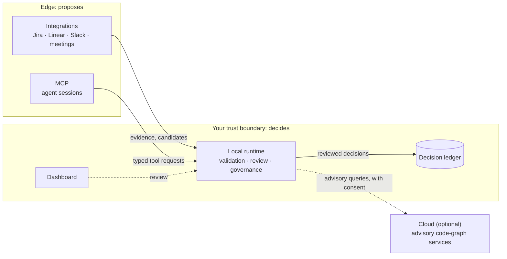

<p align="center">
  <picture>
    <source media="(prefers-color-scheme: dark)" srcset="docs/assets/branding/bicameral-lockup-dark.svg">
    
  </picture>
</p>

<h3 align="center">The decision ledger for engineering and product teams</h3>

<p align="center">
  Capture the decisions that constrain your code, ground them in the code itself,<br>
  and keep a human in the loop before any claim becomes authority.
</p>

<p align="center">
  <a href="https://github.com/BicameralAI/bicameral/actions/workflows/governance.yml"></a>
  <a href="LICENSE"></a>
  <a href="#current-status"></a>
  <a href="docs/architecture/INDEX.md"></a>
  <br>
  <a href="SECURITY.md"></a>
  <a href="SECURITY.md#compliance-posture"></a>
  <a href="tools/governance/"></a>
</p>

<p align="center">
  <a href="#how-bicameral-works"><b>How it works</b></a> ·
  <a href="docs/architecture/"><b>Architecture</b></a> ·
  <a href="GOVERNANCE.md"><b>Governance</b></a> ·
  <a href="SECURITY.md"><b>Security</b></a> ·
  <a href="CONTRIBUTING.md"><b>Contributing</b></a>
</p>

> [!IMPORTANT]
> **This repository is private consolidation staging.** It holds the governance, documentation and layout scaffold that Bicameral's components will move into. **No component code has been imported yet**, and nothing here can be installed or run as a product. Progress is tracked in [Factory #969](https://github.com/BicameralAI/bicameral-factory/issues/969).

## Why Bicameral

Teams rarely fail because nobody wrote a decision down. They fail because product intent, architectural constraints and implementation drift apart while work is happening. The decision is in a ticket, the rationale is in a meeting, and the agent writing the code sees only a slice of it, then proceeds confidently.

Bicameral treats those decisions as first-class, reviewable records:

- **Grounded, not just documented.** Decisions link to source excerpts and to the code, symbols and diffs they constrain.
- **Authority is enforced, not asserted.** Integrations and agents can *propose* candidates and evidence. Only a reviewed transition in the local runtime makes something canonical.
- **Local first.** The most sensitive context (code, branches, conversations) stays at your team's trust boundary. Hosted services are optional and advisory.
- **Auditable.** Canonical decisions are replayable, attributable and reviewable.

## How Bicameral works

Bicameral is one product made of separately testable components with a strict authority boundary:



| Component | Role | Authority |
| --- | --- | --- |
| **Local runtime** | Daemon and gateway. Validates typed objects, applies governance policy, grounds claims in local code, keeps review state and the audit trail. | **Owns canonical state** |
| **Dashboard** | Human review surface for candidates and decisions. | Acts through the runtime |
| **MCP** | Agent-facing tools that map agent actions to typed requests. | Proposes only |
| **Integrations** | Provider-neutral adapters that turn source activity into evidence and candidates. | Proposes only |
| **Cloud** (optional) | Hosted advisory services, with explicit consent and tenant separation, plus a self-host path. | Advisory only |
| **Installer** | Installation and distribution. | None |

This is the intended architecture of the consolidated repository. Each boundary will be recorded as an architecture record and enforced by tests as the components arrive.

## Current status

| Area | State |
| --- | --- |
| Repository governance: structure manifest, CODEOWNERS generation, architecture records, CI check | **In place** in this repository |
| Foundational architecture records [ARCH-0001](docs/architecture/records/ARCH-0001-architecture-records-and-canonical-index.md) and [ARCH-0002](docs/architecture/records/ARCH-0002-repository-structure-and-structure-manifest.md) | **Proposed**; acceptance is a separate reviewed change |
| License | **Apache-2.0** authorized for the whole product (decision J-03) |
| Product components (runtime, dashboard, MCP, integrations, cloud, installer) | **Not imported.** They are developed in their own repositories. Each location below is reserved |
| Public release, installation from this repository, public contributions | **Not available** |

## Getting started

There is nothing to install from this repository yet. What you can do today is run the governance checks that every change must pass. They need only **Python 3.10+** and **Git**:

```bash
git clone https://github.com/BicameralAI/bicameral.git
cd bicameral
python3 tools/governance/check.py
```

The command validates the repository layout and architecture records and runs the validators' unit tests. It never modifies your working tree. See [Development and testing](#development-and-testing) for the full workflow.

## Repository structure

The layout is declared in [`governance/structure.json`](governance/structure.json), the single source of truth for where files may live and who owns them. [`.github/CODEOWNERS`](.github/CODEOWNERS) is generated from it.

| Path | Contents | Status |
| --- | --- | --- |
| [`crates/`](crates/) | Local runtime: Rust daemon, gateway, protocol (from `bicameral-bot`) | Reserved |
| [`apps/dashboard/`](apps/dashboard/) | Review dashboard (from `bicameral-bot`) | Reserved |
| [`packages/mcp/`](packages/mcp/) | MCP tool surface (from `bicameral-mcp`) | Reserved |
| [`packages/integrations/`](packages/integrations/) | Source adapters (from `bicameral-integrations`) | Reserved |
| [`services/cloud/`](services/cloud/) | Optional hosted services and self-host configuration (from `bicameral-cloud`) | Reserved |
| [`installer/`](installer/) | Installation and distribution (from `bicameral-install`) | Reserved |
| [`docs/architecture/`](docs/architecture/) | Architecture records and the generated index | Active |
| [`governance/`](governance/) | Structure manifest | Active |
| [`tools/governance/`](tools/governance/) | Governance validators and tests | Active |
| [`migration/`](migration/) | Public-safe provenance for component imports | Reserved |

Reserved locations contain only a README naming their source. The structure check rejects anything else there until an authorized import marks them active.

## Architecture and governance

- **Architecture records.** Decisions, designs and contracts are `ARCH-NNNN` records in [`docs/architecture/records/`](docs/architecture/records/), the only permitted location. [How records work →](docs/architecture/README.md)
- **Proposed versus accepted.** Only an *accepted* record carries authority, and each topic has at most one. *Proposed* records express intent and decide nothing. Writing something in this repository does not make it accepted.
- **The index is the answer.** [`docs/architecture/INDEX.md`](docs/architecture/INDEX.md) (machine-readable: [`index.json`](docs/architecture/index.json)) is generated from the records and shows which accepted record governs each topic.
- **Decision ownership.** Jin Kuan is the decision owner; maintainers review and merge within accepted policy, and nobody approves their own pull request. [Governance model →](GOVERNANCE.md)

## Security and trust

- **Reporting.** Do not file vulnerabilities as public issues. Follow [SECURITY.md](SECURITY.md).
- **CI.** The `governance` check runs on every pull request with a read-only token, no secrets, no dependency installation and a commit-pinned checkout action.
- **Review.** [GOVERNANCE.md](GOVERNANCE.md) requires every change to `main` to arrive by pull request with an independent code-owner approval. Enforcement by a repository ruleset is pending setup by a repository administrator.
- **SOC 2.** Bicameral is **preparing for a SOC 2 Type 1 examination** (Security and Confidentiality). No examination has been completed, no report has been issued, and Bicameral does not claim SOC 2 compliance or certification. [Details →](SECURITY.md#compliance-posture)

## Development and testing

```bash
python3 tools/governance/check.py           # what CI runs: structure, architecture, unit tests
python3 tools/governance/check.py --write   # regenerate CODEOWNERS and the architecture index, then validate
python3 -m unittest discover -s tools/governance/tests -t tools/governance   # unit tests only
```

Generated files are never edited by hand. Change `governance/structure.json` or a record, then run `--write` and commit the result. Component build and test instructions will be added as each component is imported.

## Contributing

Bicameral is not accepting public contributions yet. The rules that will apply are already in force for maintainers:

- [CONTRIBUTING.md](CONTRIBUTING.md): checks, file placement, architecture records, pull request evidence
- [GOVERNANCE.md](GOVERNANCE.md): roles, review rules, recorded and pending decisions
- [MAINTAINERS.md](MAINTAINERS.md) and [CODE_OF_CONDUCT.md](CODE_OF_CONDUCT.md) (Contributor Covenant 2.1)

Whether outside contributions will use a DCO sign-off or a CLA (decision J-09) is still pending.

## License and attribution

Bicameral is licensed under the [Apache License 2.0](LICENSE), the license authorized for the entire consolidated product.

Components are imported as curated source snapshots with their provenance and any third-party notices preserved, not by merging private histories. Navigator, Atlas, FinOps, TARA, related Qortara/Cortera development-support products and MythologIQ's Event Radar are separate products. They are not part of Bicameral and are not licensed by this repository.

The Bicameral name and logo are brand assets of Bicameral AI; see [`docs/assets/branding/`](docs/assets/branding/) for their source and usage rules.
