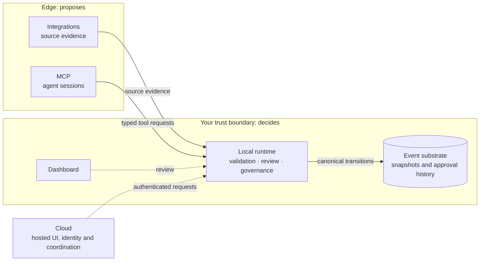

<p align="center">
  <picture>
    <source media="(prefers-color-scheme: dark)" srcset="docs/assets/branding/bicameral-lockup-dark.svg">
    
  </picture>
</p>

<h3 align="center">Human-governed context for engineering and product teams</h3>

<p align="center">
  Preserve product intent as source-backed, reviewable context,<br>
  so agents can distinguish approved guidance from unreviewed claims.
</p>

<p align="center">
  <a href="https://github.com/BicameralAI/bicameral/actions/workflows/governance.yml"></a>
  <a href="LICENSE"></a>
  <a href="#current-status"></a>
  <a href="docs/architecture/INDEX.md"></a>
  <br>
  <a href="SECURITY.md"></a>
  <a href="SECURITY.md#compliance-posture"></a>
  <a href="tools/governance/"></a>
</p>

<p align="center">
  <a href="#how-bicameral-works"><b>How it works</b></a> ·
  <a href="docs/architecture/"><b>Architecture</b></a> ·
  <a href="GOVERNANCE.md"><b>Governance</b></a> ·
  <a href="SECURITY.md"><b>Security</b></a> ·
  <a href="CONTRIBUTING.md"><b>Contributing</b></a>
</p>

> [!IMPORTANT]
> **Source consolidation complete; no unified release yet.** The Bicameral components have been consolidated here from their individual repositories, each with its layout unchanged. Releases and deployments are not produced from this repository, and an installable consolidated product is not yet available here. What has and has not been verified is listed under [Current status](#current-status).

## Why Bicameral

Teams rarely fail because nobody wrote a decision down. They fail because product intent, architectural constraints and implementation drift apart while work is happening. The decision is in a ticket, the rationale is in a meeting, and the agent writing the code sees only a slice of it, then proceeds confidently.

Bicameral's accepted design makes the source and its approval explicit:

- **Source-backed.** One immutable `SourceSnapshot` has one `GovernedDomain` containing its extracted claims and relations. Code can be supporting evidence; code-search rank does not establish authority.
- **Human-governed.** Only an approved domain governs. Approval follows Product policy and exact conflict checks; a missing or failed check is not a no-conflict result.
- **Explicit trust boundaries.** The local runtime owns canonical transitions. Hosted identity, provider access and semantic processing have separate configuration and consent requirements; local execution does not imply that all processing is offline.
- **Replayable.** Approval and source provenance must survive restart and reconstruction. A newer snapshot does not inherit the previous snapshot's approval or checks.

## How Bicameral works

The target workflow is:

```text
Source -> immutable snapshot -> extracted claims -> conflict checks
       -> human-governed approval -> reliable recall
```

[ARCH-0003](docs/architecture/records/ARCH-0003-governed-domain-is-one-source-snapshot.md), [ARCH-0004](docs/architecture/records/ARCH-0004-signoff-is-the-governed-domain.md) and [ARCH-0005](docs/architecture/records/ARCH-0005-replay-stable-governed-context-reads.md) define this model. Signoff is the approved state of a domain, not a separate `Decision` object. Full runtime enforcement and end-to-end qualification remain work in progress; the component map below is not a claim that this entire workflow is available today.



| Component | Role | Authority |
| --- | --- | --- |
| **Local runtime** | Daemon and gateway: validation, policy, canonical writes and replay. | **Owns canonical transitions** |
| **Dashboard** | Human interaction and state display. | Acts through the runtime |
| **MCP** | Agent-facing tools that map actions to typed requests and preserve returned evidence. | No independent approval authority |
| **Integrations** | Source adapters supplying evidence. | No independent approval authority |
| **Cloud** | Hosted UI, identity, pairing and Product discovery/coordination. | Does not approve domains |
| **Installer** | Installation and distribution. | None |

Legacy component names and wire contracts remain in the source during this transition. Their presence does not reinstate the retired Decision model or establish current workflow conformance.

## Current status

| Area | State |
| --- | --- |
| Repository governance: structure manifest, CODEOWNERS generation, architecture records, CI check | **In place** in this repository |
| Foundational architecture records [ARCH-0001](docs/architecture/records/ARCH-0001-architecture-records-and-canonical-index.md) and [ARCH-0002](docs/architecture/records/ARCH-0002-repository-structure-and-structure-manifest.md) | **Accepted**; they govern architecture records, the architecture index, repository layout and code ownership |
| Product model | **Accepted:** snapshot/domain identity, signoff and governed reads (ARCH-0003/0004/0005). Execution contracts and runtime completion remain tracked by [#39](https://github.com/BicameralAI/bicameral/issues/39), [#40](https://github.com/BicameralAI/bicameral/issues/40) and [#42](https://github.com/BicameralAI/bicameral/issues/42) |
| Public source and license | **Public**, with an Apache-2.0 root license. Owner publication acceptance and remaining rights, history and security follow-through are recorded in [#22](https://github.com/BicameralAI/bicameral/issues/22) |
| Product components (runtime, dashboard, MCP, integrations, cloud, installer) | **Imported** as source snapshots with their existing build and test procedures; see the [migration inventory](migration/README.md) |
| Releases and deployments | **No unified product release from this repository.** The public installer selects separately published component artifacts, not current `main`. Installer-site publication is not product-release qualification |
| Public contributions | Maintainers and invited contributors only during the transition; unsolicited external PRs are not yet accepted. See [CONTRIBUTING.md](CONTRIBUTING.md) |
| Verification | Component results are recorded at specific revisions in the [verification ledger](migration/README.md#verification-ledger). The full Create/Join topology ([#21](https://github.com/BicameralAI/bicameral/issues/21)) and governed lifecycle ([#41](https://github.com/BicameralAI/bicameral/issues/41)) are not qualified. Native macOS, Windows PowerShell 5.1 installer lifecycle and operator-service evidence also remain incomplete |

## Getting started

**Trying the product:** [the installer](installer/README.md) selects the existing component release; monorepo fixes do not reach that release automatically. Hosted signup currently requires design-partner eligibility. Self-hosting needs explicit identity, provider and signing configuration; starting a development server alone does not establish a working user journey. See [Cloud setup](services/cloud/README.md#local-setup).

The [legacy quickstart](apps/bot/QUICKSTART.md) describes the earlier candidate-promotion workflow, not an executable guide to the current governed-domain lifecycle. A replacement walkthrough must be validated against the exact released composition before it is presented as working end to end.

**Developing the source:** the following are component checks, not installation or user-journey acceptance. Use each component's specified toolchain and a separate Python virtual environment:

```bash
git clone https://github.com/BicameralAI/bicameral.git
cd bicameral

(cd apps/bot && cargo test --workspace --locked)                    # local runtime (Rust)
(cd apps/bot/dashboard && npm ci && npm run check && npm test)      # dashboard (Node 22)
(cd packages/mcp && pip install --require-hashes -r requirements-ci.lock \
   && pip install --no-build-isolation --no-deps . && pytest tests/ -q)  # MCP (Python 3.11)
(cd packages/integrations && pip install ruff==0.15.5 mypy pytest jsonschema==4.25.1 \
   && pytest adapter/core/tests connectors runtime mods scripts/tests tests/redteam tests/redaction_evaluation -q)  # integrations (Python 3.13)
(cd services/cloud && pip install -e '.[dev]' && pytest -m "not journey")  # cloud (Python 3.11+)
(cd installer && ./tests/test-unix-reconcile.sh)                    # installer
python3 tools/governance/check.py                                   # repository governance checks
```

These checks are intended for isolated development without live provider credentials. Do not substitute a production account or normal OS keyring for a disposable test environment. Each component's README has its development guide, and the exact CI commands are the `run:` steps in [`.github/workflows/`](.github/workflows/) (named `<component>-*.yml`). [`.github/workflows/installer-pages.yml`](.github/workflows/installer-pages.yml) publishes [`installer/site/`](installer/site/) to https://install.bicameral-ai.com.

## Repository structure

The layout is declared in [`governance/structure.json`](governance/structure.json), the single source of truth for where files may live and who owns them. [`.github/CODEOWNERS`](.github/CODEOWNERS) is generated from it.

| Path | Contents | Source repository |
| --- | --- | --- |
| [`apps/bot/`](apps/bot/) | Local runtime: Rust daemon, gateway, protocol, dashboard | `bicameral-bot` |
| [`packages/mcp/`](packages/mcp/) | MCP tool surface | `bicameral-mcp` |
| [`packages/integrations/`](packages/integrations/) | Source adapters and mods | `bicameral-integrations` |
| [`services/cloud/`](services/cloud/) | Hosted UI, identity, coordination and self-host configuration | `bicameral-cloud` |
| [`installer/`](installer/) | Installation scripts and install site | `bicameral-install` |
| [`docs/architecture/`](docs/architecture/) | Architecture records and the generated index | |
| [`governance/`](governance/) | Structure manifest | |
| [`tools/governance/`](tools/governance/) | Governance validators and tests | |
| [`migration/`](migration/) | Provenance for each imported component | |

Components keep their own internal layout, including their own `docs/` and pre-consolidation `docs/adr/` records. Repository-level architecture records live in `docs/architecture/records/`.

## Architecture and governance

- **Architecture records.** Decisions, designs and contracts are `ARCH-NNNN` records in [`docs/architecture/records/`](docs/architecture/records/), the only permitted location. [How records work →](docs/architecture/README.md)
- **Proposed versus accepted.** Only an *accepted* record carries authority, and each topic has at most one. *Proposed* records express intent and decide nothing. Writing something in this repository does not make it accepted.
- **The index is the answer.** [`docs/architecture/INDEX.md`](docs/architecture/INDEX.md) (machine-readable: [`index.json`](docs/architecture/index.json)) is generated from the records and shows which accepted record governs each topic.
- **Decision ownership.** Jin Kuan is the decision owner; maintainers review and merge within accepted policy, and nobody approves their own pull request. [Governance model →](GOVERNANCE.md)

## Security and trust

- **Reporting.** Do not file vulnerabilities as public issues. Follow [SECURITY.md](SECURITY.md).
- **CI.** The `governance` check runs on every pull request with a read-only token, no secrets, no dependency installation and a commit-pinned checkout action.
- **Review.** [GOVERNANCE.md](GOVERNANCE.md) requires every change to `main` to arrive by pull request with an independent code-owner approval. Repository rules are configured; evidence and remaining enforcement checks are tracked in [#22](https://github.com/BicameralAI/bicameral/issues/22). Configuration alone is not proof that every rejection path has been exercised.
- **SOC 2.** Bicameral is **preparing for a SOC 2 Type 1 examination** (Security and Confidentiality). No examination has been completed, no report has been issued, and Bicameral does not claim SOC 2 compliance or certification. [Details →](SECURITY.md#compliance-posture)

## Development and testing

```bash
python3 tools/governance/check.py           # what CI runs: structure, architecture, unit tests
python3 tools/governance/check.py --write   # regenerate CODEOWNERS and the architecture index, then validate
python3 -m unittest discover -s tools/governance/tests -t tools/governance   # unit tests only
```

Generated files are never edited by hand. Change `governance/structure.json` or a record, then run `--write` and commit the result. Each component builds and tests from its own directory (see [Getting started](#getting-started)), and CI mirrors each component's existing test workflows at the repository root.

## Contributing

Bicameral is not accepting public contributions yet. The rules that will apply are already in force for maintainers:

- [CONTRIBUTING.md](CONTRIBUTING.md): checks, file placement, architecture records, pull request evidence
- [GOVERNANCE.md](GOVERNANCE.md): roles, review rules, recorded and pending decisions
- [MAINTAINERS.md](MAINTAINERS.md) and [CODE_OF_CONDUCT.md](CODE_OF_CONDUCT.md) (Contributor Covenant 2.1)

Contributions use a Developer Certificate of Origin sign-off (`git commit -s`); there is no CLA. See [CONTRIBUTING.md](CONTRIBUTING.md#inbound-contribution-terms).


## Organizational contributors

**WhatBytes** contributes engineering, testing, and maintenance support to Bicameral through Aritro Roy and Mayur Sonar. See [Maintainers and continuing contributors](MAINTAINERS.md#organizational-contributors) for recognition and governance boundaries. Organizational participation does not confer repository or product authority.

## License and attribution

The repository carries the [Apache License 2.0](LICENSE) (J-03). The owner's [publication acceptance](https://github.com/BicameralAI/bicameral/issues/22#issuecomment-6380066910), rights/provenance evidence and remaining follow-through are recorded in [#22](https://github.com/BicameralAI/bicameral/issues/22) and the [migration record](migration/README.md#rights-evidence). Public visibility does not by itself close the remaining evidence items.

Components are imported as curated source snapshots with their provenance and any third-party notices preserved, without importing unrelated source histories. Navigator, Atlas, FinOps, TARA, related Qortara/Cortera development-support products and MythologIQ's Event Radar are separate products. They are not part of Bicameral and are not licensed by this repository.

The Bicameral name and logo are brand assets of Bicameral AI; see [`docs/assets/branding/`](docs/assets/branding/) for their source and usage rules.
