# Evidence Refresh Currentness Roadmap

Principle: Evidence refresh is a reviewable currentness lifecycle; it must not assert signoff, compliance, or graph authority.

## Problem

Issue #373 exposed a command-contract gap around `refresh_source` and
`resolve_compliance`. The deeper runtime gap is that evidence refresh was
deferred together with compliance even though currentness refresh is a separate
functional pipeline.

Before the MCP thin-client refactor, `bicameral-mcp` owned a built-out
`link_commit(HEAD)` / `ensure_ledger_synced` path. That path could notice repo
movement, inspect changed code, and surface stale grounding/compliance follow-up.
Current architecture correctly removes MCP-local authority, but the equivalent
bot-owned evidence refresh lifecycle is not yet complete.

## Current Implementation Snapshot

- Intended owner: `bicameral-bot` runtime/daemon.
- Previous owner: `bicameral-mcp` sync middleware and `link_commit`.
- Existing primitives: `SnapshotResolver`, `FileInspector`,
  `GraphReadiness`, `GraphEvidenceState`, `CodeSourceRefreshResult`,
  binding lineage/revalidation concepts, and deferred ToolRequest command
  variants.
- Missing transition: tracked Decision + ready graph handoff ->
  materialized evidence currentness outcome.
- Related issues: #373, #374, #377, #378, #194, #221, #230,
  BicameralAI/bicameral-mcp#594.

## State Machine

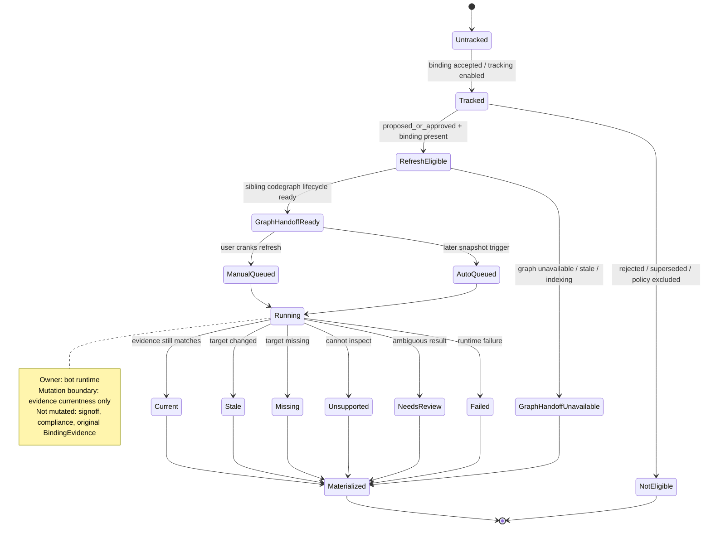

## Horizontal Dependency Snapshot

| Lifecycle / Surface | Relationship | Owner | State Dependency | Notes |
|---|---|---|---|---|
| Evidence refresh/currentness | primary | bot runtime | tracked Decision + binding + codegraph handoff | Replaces old MCP-owned sync behavior. |
| Codegraph / GraphSnapshot lifecycle | requires | bot runtime / local graph service | ready graph snapshot or typed unavailable state | Sibling lifecycle; this roadmap consumes its handoff only. |
| Signoff | orthogonal | governance / bot | read for eligibility only | Approved does not mean current or compliant. |
| Binding evidence | requires | bot runtime | accepted binding target | Original BindingEvidence remains immutable. |
| MCP ToolRequest | replaces | MCP thin client -> bot | explicit request/response only | MCP must not rebuild graph, mutate ledger, or compute compliance. |
| Dashboard UX | feeds | dashboard -> bot | manual crank command | Button appears only when eligible. |
| Preflight/search/history | feeds | bot query/read APIs | currentness caveats | No hidden mutation during reads. |
| Compliance | blocked-by-policy / downstream | bot governance | may consume refreshed evidence later | Refresh must not produce compliance verdicts. |
| QA/regression | requires | CI/runtime tests | transition matrix | Refactors must preserve explicit states. |

## Sibling Lifecycle Stubs

### Sibling: Codegraph / GraphSnapshot lifecycle

- Relationship to this roadmap: required prerequisite.
- Intended owner: bot runtime or bot-managed local graph service.
- Release state needed by this roadmap: graph handoff for a requested commit is
  either ready or explicitly unavailable/stale/indexing/not configured.
- Handoff state consumed by this roadmap: `GraphReadiness` and, when ready, a
  `GraphSnapshot`/slice usable for binding currentness evaluation.
- What this roadmap must not decide: rebuild strategy, cache topology,
  slice-expansion policy, indexing concurrency, durable cache layout, or hosted
  graph behavior.
- Open questions for sibling spec: tracked in #378 and related to #230.

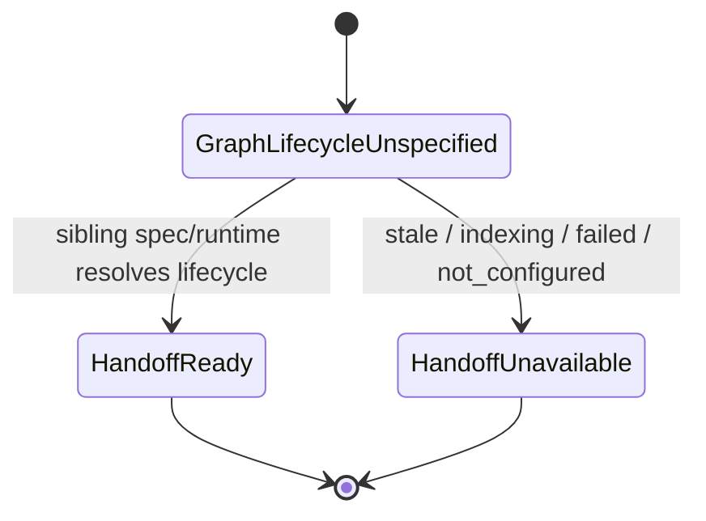

## Vertical Stage Roadmap

### Stage 0: Contract clarity

Resolution: Separate deferred compliance from evidence refresh/currentness and
stop empty-success ambiguity.

Resolution level: high

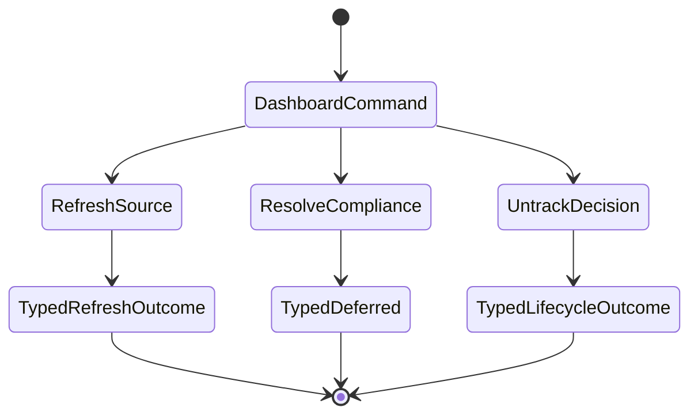

Runtime implications:

- Owner: bot gateway/runtime contract.
- Trigger: dashboard/API command.
- UX behavior: users see refresh unavailable/currentness outcome separately from compliance.
- Fallback behavior: typed JSON for deferred, unsupported, ineligible, and graph handoff unavailable.
- Persistence/materialization: none for deferred/unsupported contract responses.
- QA signal: contract tests assert response body and no mutation.

Acceptance criteria:

- Typed outcomes distinguish refresh, deferred compliance, and untrack lifecycle.
- Signoff, currentness, and compliance are named as separate states.
- Empty 202 success is not used for deferred behavior.

### Stage 1a: Codegraph handoff contract

Resolution: Evidence refresh receives a ready-or-unavailable graph handoff from
the sibling codegraph lifecycle.

Resolution level: high

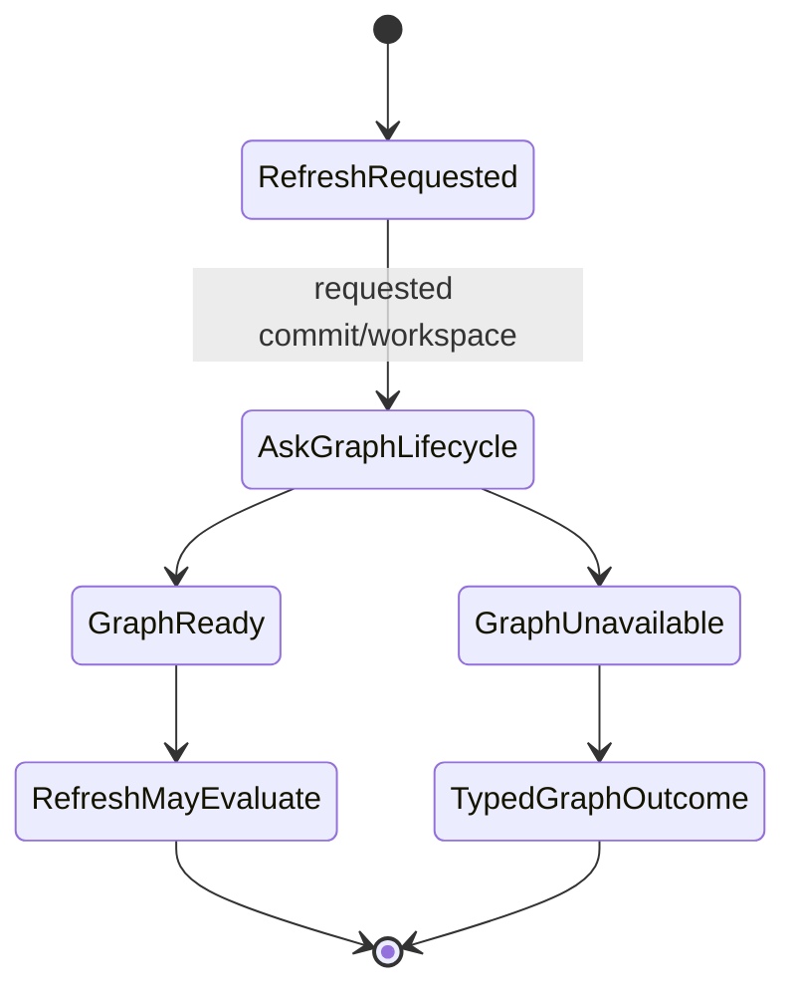

Runtime implications:

- Owner: evidence refresh consumes the handoff; codegraph lifecycle owns producing it.
- Trigger: manual refresh request.
- UX behavior: unavailable graph states are visible as refresh blockers.
- Fallback behavior: `not_configured`, `stale`, `indexing`, `failed`,
  `unknown_not_indexed`, or equivalent typed outcome.
- Persistence/materialization: handoff result is derived unless sibling spec says otherwise.
- QA signal: manual refresh can return graph-handoff unavailable without evaluating binding currentness.

Acceptance criteria:

- Refresh does not assume commit resolution implies codegraph readiness.
- #378 answers whether #377 depends on #230 or includes a minimal handoff adapter.
- Graph unavailable is not treated as current, stale, or compliant.

### Stage 1b: Manual evidence refresh tracer bullet

Resolution: One user can crank one tracked Decision through currentness
evaluation after the codegraph handoff is ready.

Resolution level: high

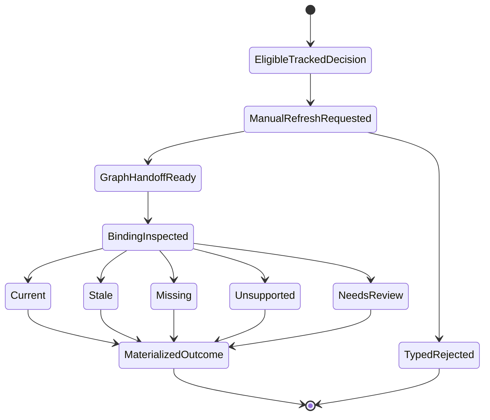

Runtime implications:

- Owner: bot runtime owns evaluation and mutation.
- Trigger: explicit dashboard/MCP/CLI refresh command.
- UX behavior: refresh button updates currentness only.
- Fallback behavior: ineligible Decision, no binding, unsupported evidence, ambiguous evidence.
- Persistence/materialization: derived currentness read model or accepted event if policy requires.
- QA signal: fixture Decision reaches each terminal currentness outcome.

Acceptance criteria:

- Manual refresh works for one tracked Decision when graph handoff is ready.
- Signoff and compliance are unchanged.
- Original BindingEvidence is not rewritten.

### Stage 2: Bot-owned replacement for MCP `link_commit`

Resolution: Old MCP sync semantics move behind bot-owned runtime commands.

Resolution level: medium

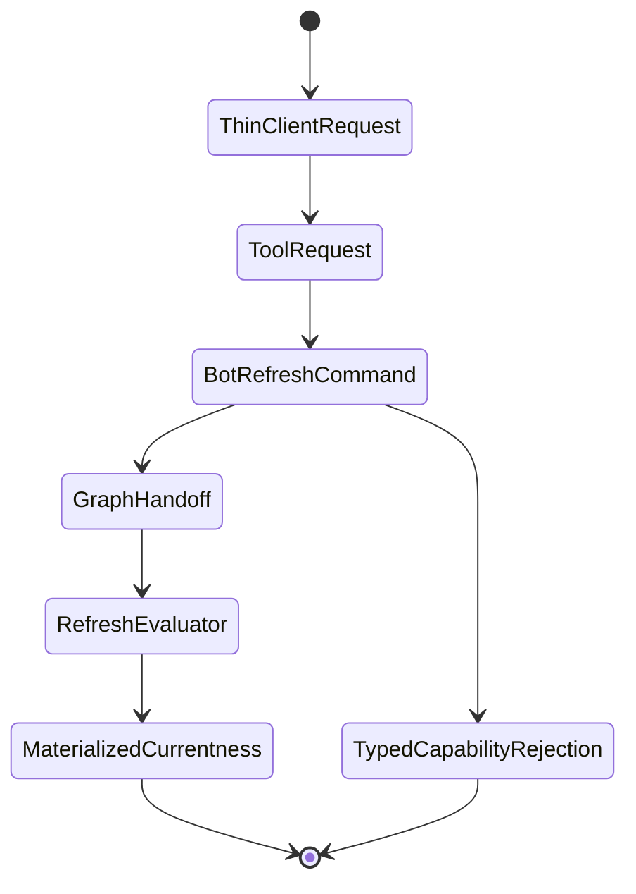

Runtime implications:

- Owner: bot runtime; MCP is request/display only.
- Trigger: MCP/dashboard/CLI submits explicit command.
- UX behavior: surfaces show queued/running/outcome but cannot mutate locally.
- Fallback behavior: capability rejection if daemon lacks refresh.
- Persistence/materialization: bot-owned state only.
- QA signal: MCP conformance tests prove no local `link_commit` path remains.

### Stage 3: Automatic catch-up loop

Resolution: Repo snapshot movement queues refresh for eligible tracked Decisions.

Resolution level: medium

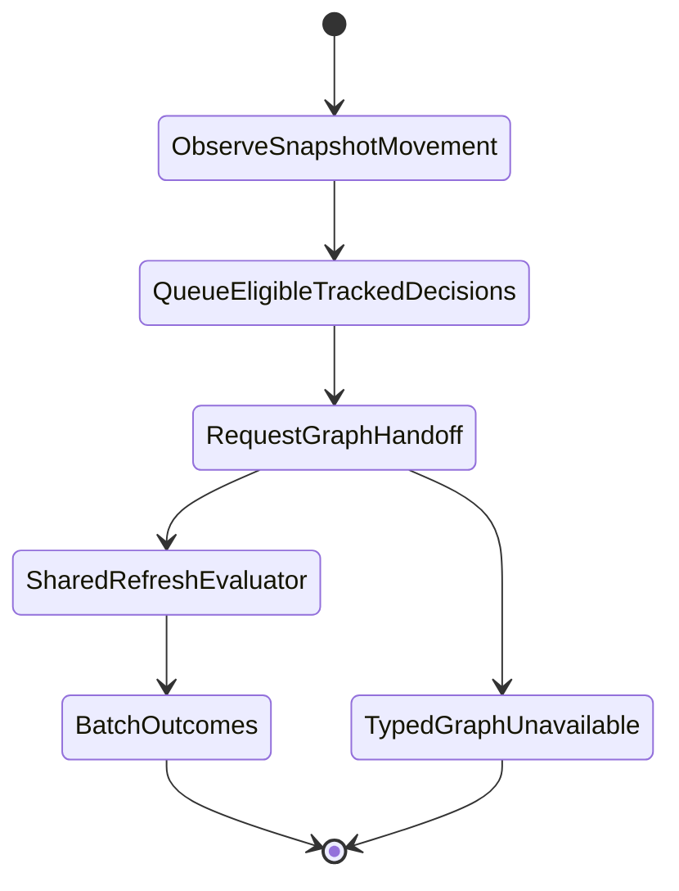

Runtime implications:

- Owner: bot runtime/local daemon or approved hook.
- Trigger: deterministic snapshot delta.
- UX behavior: users see auto refreshed at snapshot X, queued, or graph unavailable.
- Fallback behavior: dirty worktree, detached HEAD, missing repo, unsupported inspector.
- Persistence/materialization: batch metadata and per-Decision outcomes.
- QA signal: fixture repo movement queues exactly eligible tracked Decisions.

### Stage 4: Read model and UI separation

Resolution: Review surfaces show signoff, tracking, currentness, graph readiness,
and compliance separately.

Resolution level: medium

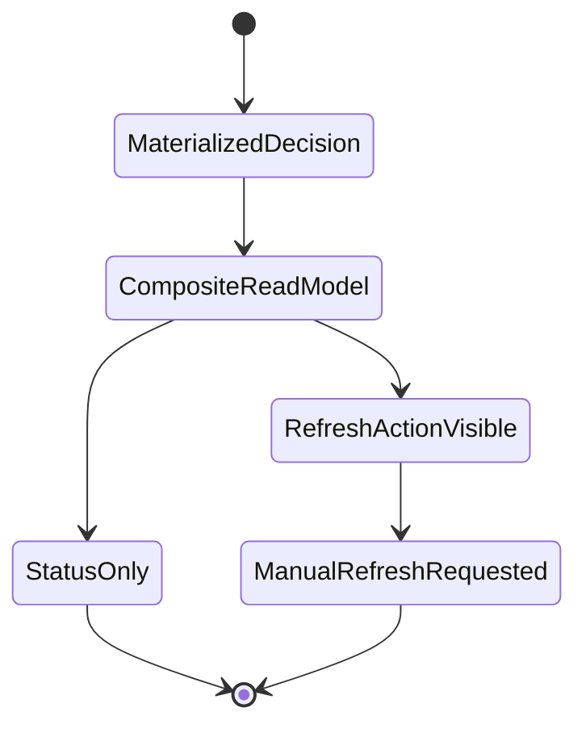

Runtime implications:

- Owner: bot read model plus dashboard rendering.
- Trigger: dashboard/search/history/preflight read.
- UX behavior: approved-but-stale remains two facts, not one badge.
- Fallback behavior: unknown/unsupported states remain visible.
- Persistence/materialization: rendered from bot-owned state.
- QA signal: read-model tests cover approved+stale, approved+current, ungrounded, unsupported.

### Stage 5: Downstream consumers preserve caveats

Resolution: Search, history, and preflight consume currentness without
overstating guarantees.

Resolution level: coarse

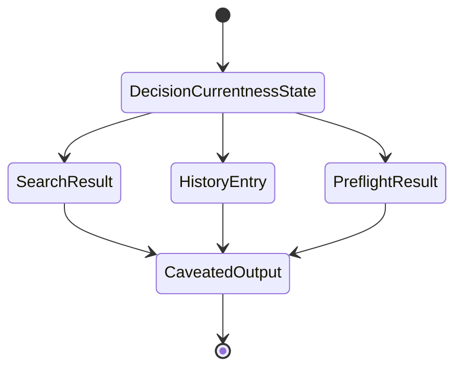

Runtime implications:

- Owner: bot query/read APIs; MCP displays daemon-authored caveats.
- Trigger: user asks search/history/preflight.
- UX behavior: stale/unknown/ungrounded constraints remain usable but caveated.
- Fallback behavior: unknown currentness stays unknown; reads do not mutate.
- Persistence/materialization: none beyond primary lifecycle state.
- QA signal: query tests assert caveat propagation.

### Stage 6: Compliance consumes refreshed evidence later

Resolution: Compliance is a separate downstream lifecycle.

Resolution level: coarse

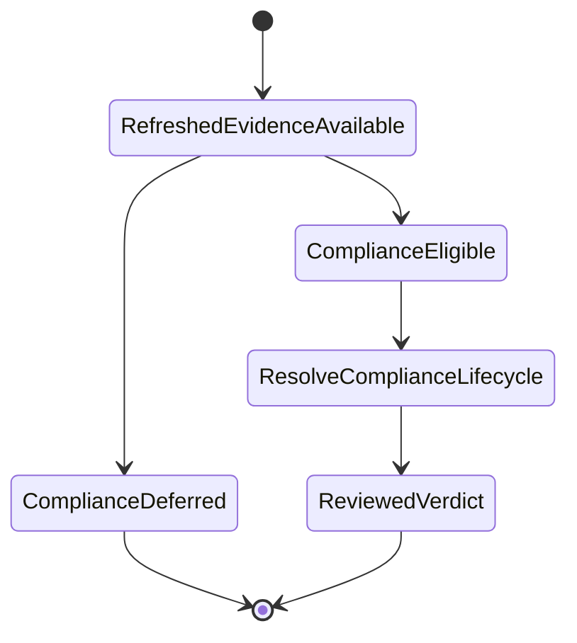

Runtime implications:

- Owner: bot governance/compliance runtime.
- Trigger: explicit compliance command or later policy-enabled review.
- UX behavior: compliance action appears separately and only when prerequisites are met.
- Fallback behavior: deferred/pending when evidence is missing, stale, unsupported, or policy disabled.
- Persistence/materialization: compliance verdict/event separate from refresh outcome.
- QA signal: refresh can complete with compliance unchanged.

### Stage 7: State-machine regression gates

Resolution: Refactors cannot remove refresh behavior or collapse state boundaries
without failing tests.

Resolution level: coarse

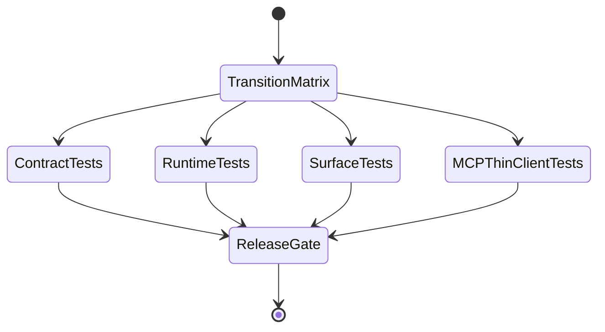

Runtime implications:

- Owner: bot and MCP CI suites.
- Trigger: PR checks/regression suite.
- UX behavior: prevents button/API ambiguity.
- Fallback behavior: unsupported/deferred behavior must be explicit and tested.
- Persistence/materialization: fixture event logs/snapshots for replay tests.
- QA signal: matrix covers manual, auto, stale, unsupported, deferred, failed, and compliance-separated paths.

## Invariants

- Evidence refresh may update currentness/readiness only.
- Evidence refresh must not assert compliance.
- Signoff approval must not imply evidence is current.
- MCP may submit/display ToolRequests but must not own ledger, graph, compliance, or refresh mutation.
- Automatic refresh and manual refresh share evaluator semantics.
- Unknown, unsupported, stale, and deferred are explicit states.

## Proposed Vertical Slices

1. Stage 0: typed command outcomes for refresh/deferred compliance/untrack.
2. Stage 1a: codegraph handoff contract for manual refresh.
3. Stage 1b: manual evidence refresh for one tracked Decision.
4. Stage 2: bot-owned refresh command replacing MCP `link_commit` semantics.
5. Stage 3: automatic snapshot-delta refresh queue.
6. Stage 4: dashboard/read-model state separation.
7. Stage 5: currentness caveats in search/history/preflight.
8. Stage 6: compliance consumes refreshed evidence as a separate lifecycle.
9. Stage 7: state-machine QA matrix and regression gates.

## Project Placement

Track implementation through the Product Validation Roadmap and related GitHub
issues. This roadmap bridges Advisory Code Grounding, Grounded Constraint
Discovery, Code Compliance, EM Review Surface, and Tool-Agnostic work.

## Open Questions

- Should the public command be `tracking.refresh_query`, `refresh_source`, or
  `evidence.refresh`?
- Does #377 depend directly on #230, or can it include a minimal codegraph
  handoff adapter after #378 resolves the runtime architecture?
- Which refresh outcomes are durable governance events versus derived read-model
  state?
