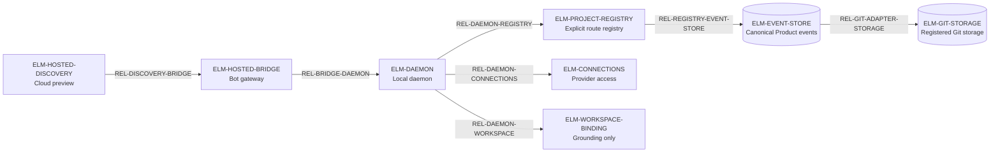

# Runtime Architecture: Explicit Project Registration And Hosted/Local Discovery

Date: 2026-06-24

Status: draft

Level: L2 cross-repo contract

Owns: the setup/discovery contract that replaces implicit filesystem project discovery with explicit hosted or local project registration.

Related context: BicameralAI/bicameral-bot#538, BicameralAI/bicameral-bot#540, BicameralAI/bicameral-cloud#8, BicameralAI/bicameral-bot#539, ADR-0001, ADR-0003, ADR-0007, ADR-0023, `docs/specs/project-setup-ui.md`, `docs/specs/rendezvous-state-machine.md`, `docs/specs/oauth-and-integration-connections.md`, `docs/specs/hosted-bridge-user-level-pairing.md`, `docs/specs/domain-product-onboarding-contract.md`.

> The domain-discovered Product auto-join create/publish/discover/join flow is
> reconciled authoritatively in
> [`domain-product-onboarding-contract.md`](domain-product-onboarding-contract.md)
> (issue #765). This spec owns the local registration/discovery mechanics
> (`HostedProjectPreview`, `ProjectRegistration`, `LocalWorkspaceBinding`); the
> onboarding contract owns `product.create`/`product.join`, atomic creator-role
> materialization, `ProductJoinTicket` claims, membership events/receipts, and
> Cloud publication authority.

Governance gate: `bic:spec-governance-gate` advisory/no-op; Qor integration disabled pending factory policy revision.

## Reading Guide

Read `Runtime Invariant`, `Conformance Gap Summary`, `Decision`, `Runtime State Classification, Authority, Persistence, And Routing`, and `Runtime Architecture Conformance` first. The main invariant is:

```text
Project identity comes from explicit registration,
not ambient filesystem discovery.
```

## Runtime Invariant

The local daemon must not select a Bicameral project by walking upward from the current directory to find `.bicameral/`.

Every runnable project must be explicitly registered through one of two paths:

- hosted discovery and local daemon registration;
- local-only create/join/register flow.

Repo-local `.bicameral/` may exist only as Git event-store storage for an explicitly registered Git-substrate project. It is not a general project locator.

## Runtime Problem

ADR-0023 intentionally separated operator home, project registry, workspace setup, daemon startup, and dashboard configuration, but it still describes the current implementation's upward `.bicameral/` discovery as a transitional layout. RFQ #538 resolves that transition: implicit filesystem discovery should not remain a supported product path.

If implementation issues proceed without this spec, workers may preserve two competing identity models:

- ambient cwd/path discovery;
- explicit hosted/local registration.

That would create confusing setup behavior, unclear recovery paths, and a hidden backwards-compatibility burden. The product wants the simpler model: choose/register the project explicitly, then validate local access.

## Conformance Gap Summary

Status vocabulary: `proven` means the required implementation and executable evidence are cited; `partial` means the path exists but the required topology or cross-boundary evidence is incomplete; `missing` means the required implementation or evidence does not yet exist; `unresolved` means the owning contract is not yet decided.

| Conformance ids | Intended contract | Current implementation / evidence | Status | Missing evidence or work |
| --- | --- | --- | --- | --- |
| CONF-REGISTRATION-PERSISTENCE-01 | Accepted Product registrations survive daemon restart under the operator home | `ProjectRegistrationStore` and setup idempotency tests exist | partial | One restart test must prove recovery without Product-ledger or process-memory fallback |
| CONF-EXPLICIT-ROUTING-01, CONF-NO-CWD-DISCOVERY-01 | Product and adapter selection come only from explicit registration | `ProjectEventStoreRouter` exists, but the cross-cwd fixture and startup classification witness are planned | missing | Cross-cwd, multi-Product restart topology test and removal/rejection of upward `.bicameral/` selection |
| CONF-CANONICAL-EVENTS-01 | Only the selected Product event-store adapter materializes accepted events | Event-store conformance and replay tests exist | proven | Preserve the row in every adapter implementation slice |
| CONF-HOSTED-NONAUTHORITY-01 | Hosted preview/publication routes but never creates canonical Product identity or events | Hosted onboarding fixtures and bridge contracts cover portions of the boundary | partial | Confirm the hosted journey boundary and run producer/consumer plus terminal journey evidence |
| CONF-WORKSPACE-NONIDENTITY-01 | A local folder is a Product-keyed grounding binding, not Product identity | Workspace-binding dispatch conformance exists | proven | Preserve the negative identity assertion in future binding changes |

## Goals

- Remove implicit `.bicameral/` project discovery from the product model.
- Define hosted discovery as a non-canonical project preview and routing surface.
- Define explicit local registration as the local daemon's only way to select a runnable project.
- Preserve a local-only fallback that does not require hosted discovery.
- Keep the selected event-store substrate authoritative for canonical project settings and Decision Ledger events.
- Treat repo-local `.bicameral/` as Git event-store storage only after registration.
- Minimize setup states and user-facing setup copy.
- Name ADR/spec amendments before implementation slicing.

## Non-Goals

- No general filesystem scan or implicit workspace import. A bounded startup
  migration may import canonical Products and legacy registration events only
  from the daemon's explicitly configured event-store adapter.
- No upward `.bicameral/` walking as a setup, repair, or hidden fallback path.
- No InviteBundle or Pairing Notice revival as a product join mechanism.
- No hosted canonical project settings.
- No implicit source binding from provider connection, project preview, or local folder selection.
- No implicit BindingEvidence or graph authority from local workspace selection.
- No change to Decision Ledger event-store authority.

## Decision

Deprecate implicit project discovery entirely.

The daemon may start in setup or repair mode without a selected project, but it must reach normal mode only after an explicit project registration exists and the selected event-store descriptor validates.

The supported project entry paths are:

```text
Hosted discovery path:
  hosted web presents project preview or join/create flow
  -> local daemon pairs hosted session to the local operator home
  -> local daemon validates local operator state and provider access
  -> local daemon writes explicit ProjectRegistration
  -> local daemon opens selected event-store substrate
  -> replay produces normal project state

Local-only path:
  local dashboard/CLI create, join, or register command
  -> local daemon validates local operator state and provider access
  -> local daemon writes explicit ProjectRegistration
  -> local daemon opens selected event-store substrate
  -> replay produces normal project state
```

Git-backed projects may store events and reviewable materializations under repo-local `.bicameral/`, but the local daemon finds that storage through `ProjectRegistration`, not by scanning the filesystem.

## Runtime Components

These stable element ids are the source of any generated C4 projection.

| ID | C4 kind | Component / deployment | Responsibility | Persistent state ids | Multiplicity | Must not decide or mutate |
| --- | --- | --- | --- | --- | --- | --- |
| ELM-HOSTED-DISCOVERY | Software system / Cloud | Hosted discovery surface in `bicameral-cloud` | Render Product previews, create/join affordances, pairing prompts, and non-canonical routing metadata | REG-004 | Many Cloud accounts and Products | Canonical Product settings, Decision events, local provider tokens, local workspace bindings |
| ELM-HOSTED-BRIDGE | Container / bot gateway | Hosted bridge route family in `bicameral-bot` | Authenticate a paired browser origin and route allowlisted operator-home requests | REG-009 | Many browser sessions to one operator home | Product selection, direct ToolRequest fallback, canonical writes, local secrets |
| ELM-DAEMON | Container / local process | Local `bicameral-bot` daemon | Validate operator state and access, persist registration, route to the selected event-store adapter, and replay Product state | REG-002, REG-003, REG-008, REG-009 | One process may serve many registered Products and adapters | Hosted membership or canonical Decision authority outside governed event-store materialization |
| ELM-OPERATOR-HOME | Datastore / local | User-level control plane under `~/.bicameral/` | Persist registrations, connection metadata, workspace bindings, and operational receipts | REG-002, REG-003, REG-005, REG-006, REG-008, REG-009 | One per operating-system user | Canonical Decision Ledger state |
| ELM-PROJECT-REGISTRY | Component / local daemon | `crates/bicameral-runtime/src/project_registry.rs` | Resolve explicit `(product_id, cloud_account_id)` registrations to event-store routes | REG-002, REG-003 | Many registrations per operator home | Provider secrets, source authority, or binding authority |
| ELM-EVENT-STORE | Datastore / selected substrate | Git, Drive, memory-test, or future `EventStoreAdapter` | Persist canonical Product settings and accepted events | REG-001, REG-007 | Many Products and potentially many adapter instances | Pairing, hosted preview, or local code graph caches |
| ELM-CONNECTIONS | Component / local daemon | Provider connection service and approved secret store | Resolve user-level provider access | REG-005 | Many connections per operator | Source binding, Product authority, or membership |
| ELM-WORKSPACE-BINDING | Component / local daemon | `crates/bicameral-runtime/src/workspace_binding.rs` | Persist an explicit local code-folder relation for grounding/preflight | REG-006 | Zero or more bindings per Product | Product identity, `SourceBinding`, or `BindingEvidence` |
| ELM-GIT-STORAGE | Datastore / Product repo | Registered repo-local `.bicameral/events/` | Store Git-adapter accepted events and materializations | REG-007 | One path per registered Git Product route | Product discovery, operator identity, or local secrets |

## Runtime Relationships

| ID | Source -> destination | Interaction / medium | Handoff | State / payload | Boundary crossed |
| --- | --- | --- | --- | --- | --- |
| REL-DISCOVERY-BRIDGE | ELM-HOSTED-DISCOVERY -> ELM-HOSTED-BRIDGE | HTTPS hosted pairing and allowlisted bridge requests | Synchronous request/response | REG-004 preview metadata and REG-009 receipts | Hosted to operator-local trust boundary |
| REL-BRIDGE-DAEMON | ELM-HOSTED-BRIDGE -> ELM-DAEMON | In-process gateway dispatch after origin/session/capability checks | Synchronous | Registration intent; never canonical events | Browser session to local authority boundary |
| REL-DAEMON-REGISTRY | ELM-DAEMON -> ELM-PROJECT-REGISTRY | Rust module call and atomic local file persistence | Persisted handoff | REG-002, REG-003, REG-008 | Process to operator-home persistence boundary |
| REL-REGISTRY-EVENT-STORE | ELM-PROJECT-REGISTRY -> ELM-EVENT-STORE | Explicit adapter descriptor lookup | Synchronous selection, then persisted adapter I/O | REG-001 through route REG-002 | Operator routing to Product canonical-store boundary |
| REL-DAEMON-CONNECTIONS | ELM-DAEMON -> ELM-CONNECTIONS | Local credential/access resolution | Synchronous | REG-005 | Runtime to approved secret-store boundary |
| REL-DAEMON-WORKSPACE | ELM-DAEMON -> ELM-WORKSPACE-BINDING | Explicit bind/read/revoke module calls | Persisted local handoff | REG-006 | Product runtime to local filesystem boundary |
| REL-GIT-ADAPTER-STORAGE | ELM-EVENT-STORE -> ELM-GIT-STORAGE | Git adapter filesystem and repository operations | Persisted | REG-001, REG-007 | Adapter to registered Product repository |

## Derived Topology View

This review aid is generated from the `ELM-*` and `REL-*` tables. It introduces no independent node, edge, or authority claim.



## Runtime State Classification, Authority, Persistence, And Routing

These stable rows are the input to runtime topology/C4 generation and the
required executable topology tests. Classification alone is insufficient: each
row connects authority to a persistence owner, routing key, concrete module,
and prohibited fallback.

| ID | Artifact | Classification | Persistence owner | Routing key | Concrete module | Prohibited fallback | Executable topology evidence |
| --- | --- | --- | --- | --- | --- | --- | --- |
| REG-001 | Decision Ledger events | Canonical accepted events | Selected `EventStoreAdapter` | Product event-store descriptor | `event_store_adapters` + governed dispatch | Hosted discovery or operator registry writes accepted events | Event-store conformance suites |
| REG-002 | Event-store route | Operator-private routing descriptor | `~/.bicameral/projects/` | `(product_id, cloud_account_id)`; adapter resolution by `product_id` | `project_registry::EventStoreRoute` | Daemon cwd or upward `.bicameral` discovery | `project_registration_routing` restart topology test |
| REG-003 | `ProjectRegistration` | Operator-local state | `~/.bicameral/projects/<product_id>--<cloud_account_id>.json` | `(product_id, cloud_account_id)` | `project_registry::{ProjectRegistrationStore, ProjectEventStoreRouter}` | Product event ledger, hosted Cloud, or process memory as sole owner | Product setup idempotency + zero-registration-event tests |
| REG-004 | `HostedProjectPreview` | Derived preview/routing metadata | Hosted discovery service | Canonical `product_id` | Hosted discovery/bridge projection | Treat preview as event-store truth | Hosted Product creation/publication conformance |
| REG-005 | `ConnectionMetadata` | Operator-local non-secret metadata | Operator connection registry | Connection id / opaque descriptor ref | Provider connection service | Treat connection as source binding or Product authority | Connection schema and redaction tests |
| REG-006 | `LocalWorkspaceBinding` | Operator-local state | `~/.bicameral/workspace-bindings/` | `product_id` | `workspace_binding::FileWorkspaceBindingStore` | Treat binding as `BindingEvidence` or Product identity | Workspace-binding dispatch conformance |
| REG-007 | Repo-local `.bicameral/events/` | Git canonical-event storage | Registered Git Product repository | Registered event-store route | `event_store_adapters::GitAdapter` | Discover selected Product by path walk | Registered Git replay + cross-cwd routing tests |
| REG-008 | `PendingRegistration` | Local scratch/recovery state | Local daemon setup store | Setup request / Product id | Product setup state machine | Treat pending state as runnable Product | Setup repair-state tests |
| REG-009 | Setup receipts/logs | Audit/receipt/log | Operator operational-log store | Request id | `operational_log::OperationalLogStore` | Treat receipt as approval, event, membership, or route | Redaction and retention tests |

## State Refinement Check

Release state: a hosted browser can pair with the local operator home before a project is selected. A user can then create, join, select, and open a Bicameral project only through explicit hosted or local registration. Normal daemon project mode requires a valid `ProjectRegistration` and validated event-store access.

States added or refined:

- `unregistered`: operator home exists, but no project has been selected or registered for this session.
- `hosted_project_preview`: hosted, non-canonical metadata sufficient to show a project and route the user to local registration.
- `pending_registration`: local recovery state while provider auth, event-store validation, or daemon pairing is incomplete.
- `registered_project`: operator-local record that points to a selected event-store descriptor and local access binding.
- `registration_repair_required`: registered project cannot open until provider access, event-store descriptor, or local workspace binding is repaired.
- `normal_project_running`: daemon has opened the selected event-store substrate and replayed canonical state.
- `hosted_bridge_unpaired`: hosted web can see only pairing/setup affordances; it cannot read local projections or request governed actions.
- `hosted_bridge_paired`: hosted web is paired to the local operator home through a checked origin, local session, and capability handshake. It may list locally registered projects and request setup/repair flows allowed by local policy; it does not by itself select a project or bind a workspace.
- `hosted_bridge_revoked`: prior hosted pairing is invalid and must not be reused for reads or actions.

Transitions:

| Transition | Trigger | Authority | Persistence |
| --- | --- | --- | --- |
| Preview project | User signs into hosted surface or resolves hosted invite | Hosted discovery service | Hosted preview metadata only |
| Start registration | User selects hosted preview or local create/join/register | Local daemon | `PendingRegistration` |
| Pair hosted bridge | User approves hosted web connection to local Bicameral operator home | Local daemon after origin/session/capability checks | Operator-home pairing/session record |
| Revoke hosted bridge | User revokes pairing or pairing expires | Local daemon | Pairing/session marked revoked or removed |
| Connect provider | User authorizes provider connection | Provider connection service via local daemon | Connection registry and secret store |
| Validate event store | Local daemon checks event-store descriptor with local connection/access | Local daemon | Setup receipt; no canonical mutation |
| Accept registration | Event-store access validates and project identity is stable | Local daemon | `ProjectRegistration` |
| Import legacy route | Daemon starts with one explicitly configured event store containing an existing Product or legacy registration event | Local daemon migration reader | Idempotent operator-registry record; no Product event write |
| Open normal mode | Daemon opens adapter and replays event store | Local daemon + EventStoreAdapter | Local caches/projections from replay |
| Repair registration | Provider, descriptor, or local access changes | Local daemon | `registration_repair_required` until fixed |
| Revoke/remove local registration | User removes local access | Local daemon | ProjectRegistration removed or marked inactive; canonical events unchanged |

Invariants:

- Project discovery is not project authority.
- Provider connection is not source binding.
- Local folder selection is not BindingEvidence.
- Hosted preview metadata is not event-store truth.
- Repo-local `.bicameral/` is not a project locator.
- Pending registration is not a runnable project.
- Hosted bridge pairing is not project membership, project selection, workspace binding, signoff, source authority, event-store authority, or permission to bypass bot-owned action authorization.

Deferred vocabulary:

- Hosted canonical project settings.
- Automatic local repo inference.
- Universal project discovery across all substrates.
- Implicit source binding.
- Legacy InviteBundle/Pairing Notice flow.
- General migration/import state for filesystem-discovered workspaces. The
  bounded configured-adapter import is a startup compatibility action, not a
  lifecycle state.

## State Minimization Review

Accepted states are the smallest honest setup lifecycle that changes behavior:

- `hosted_project_preview` is needed because hosted discovery can route users without owning canonical settings.
- `pending_registration` is needed for OAuth, pairing, and event-store validation recovery.
- `registered_project` is needed because project identity must be explicit and durable locally.
- `registration_repair_required` is needed because a registered project may become inaccessible without losing local identity.

Rejected or collapsed states:

- `workspace_marker_only` is rejected as a product state; a marker-only `.bicameral/` is ignored unless a registered Git event-store project points at it.
- `workspace_incomplete` collapses into `pending_registration` before acceptance or `registration_repair_required` after acceptance.
- `operator_state_missing` collapses into operator bootstrap; it is not a project discovery state.
- `project_joined` is renamed conceptually to `registered_project` to avoid implying hosted membership or event-store replay succeeded.
- Migration/import states are rejected because configured-adapter backfill is
  idempotent startup reconciliation, not a user-visible lifecycle state.
- `hosted_bridge_origin_rejected`, `hosted_bridge_token_rejected`, and `hosted_bridge_command_unsupported` collapse into typed bridge error outcomes unless they require distinct user-visible repair.

## Hosted Bridge Contract

> The dedicated hosted bridge pairing spec is at
> `docs/specs/hosted-bridge-user-level-pairing.md`. That spec persists the #539
> owner decision as durable bot authority and covers the user/project/workspace
> state split, data flow, route requirements, UX shape, and ADR implications
> in detail.

Decision for #539: the hosted bridge is a paired route family on the bot
gateway, not a separate authority surface and not the same contract as external
ingest.

Pairing is user/operator-level, not workspace-level. Hosted web pairs with the
local operator home and local daemon runtime first. After that, hosted web may
ask the daemon for locally registered projects, readiness, registration, and
repair flows allowed by policy. Project selection and `ProjectRegistration`
happen after pairing. `LocalWorkspaceBinding` happens later still, only when a
feature needs local code grounding or preflight access.

```text
User-level:
  hosted_bridge_unpaired
  hosted_bridge_paired
  hosted_bridge_revoked

Project-level:
  unregistered
  pending_registration
  registered_project
  registration_repair_required
  normal_project_running

Workspace-level:
  local_workspace_unbound
  local_workspace_bound
  local_workspace_repair_required
```

The bot gateway may host the bridge in the same process and HTTP server as other
gateway routes. The separation is contractual:

```text
Bot gateway runtime
  -> ExternalIngestEnvelope routes
       evidence-only, no actor authority
  -> local ToolRequest routes
       local actor/session authority
  -> hosted bridge routes
       browser-origin pairing/session authority
```

Hosted bridge routes must add checks that ordinary local ToolRequest routes and
external ingest routes do not provide by themselves:

- hosted origin allowlist and CORS validation;
- CSRF and replay protection;
- local pairing lifecycle with expiry and revocation;
- capability handshake scoped to hosted bridge support;
- cloud account or hosted session mapped to a local actor only through local
  daemon policy;
- typed wrong-daemon, wrong-project, wrong-account, unsupported-command, and
  unpaired-origin errors;
- redacted local logs and diagnostics that do not leak provider tokens, local
  paths, source text, or event-store contents.

Hosted web may render, request, and relay. The local daemon validates,
authorizes, materializes, and projects Bicameral state.

### Hosted Bridge Data Flow

```text
hosted web
  -> hosted bridge route family on bot gateway
       origin/session/pairing/capability checks
  -> local operator-home bridge session
       list registered projects, setup state, repair affordances
  -> explicit project selection or registration
       ProjectRegistration required for project mode
  -> optional local workspace binding
       only when code grounding/preflight needs local files
  -> local daemon action authorization policy
       actor, capability, target state, and command checks
  -> governed command handler or projection reader
  -> selected EventStoreAdapter or derived read model
  -> typed response to hosted web
```

### Hosted Bridge UX Shape

```text
Hosted web:
  Connect this browser to your local Bicameral

Local daemon prompt:
  Signed in locally as: <operator>
  Local Bicameral: running on this machine

  Access requested:
    - list locally registered Bicameral projects
    - show setup/readiness status
    - request project registration or repair
    - request governed actions after local policy checks

  Not included:
    - provider secrets
    - filesystem access
    - workspace/code access
    - Decision approval without policy checks

  [Connect] [Cancel]

After pairing:
  Hosted web shows local project list and setup repair prompts.
  Code workspace binding is offered only inside a project when a feature needs
  local code grounding.
```

Projection reads may return only scoped read-model data that the paired local
daemon is allowed to disclose. Governed actions may be requested through the
bridge, but every canonical mutation still passes through bot-owned action
authorization and selected event-store materialization.

The bridge must not:

- reuse `ExternalIngestEnvelope` for user-approved review actions;
- allow hosted origin traffic to fall back to legacy local mutation routes;
- let hosted preview metadata become canonical project settings;
- treat cloud identity alone as a local actor;
- create Decisions, signoff, compliance, BindingEvidence, SourceEvidence, or
  external egress without the same governed path used by local surfaces.

## Authority Ownership Matrix

| Actor/component | Observe | Propose | Validate | Accept | Materialize | Project/render | Revoke |
| --- | --- | --- | --- | --- | --- | --- | --- |
| Hosted discovery | Team/project preview metadata | Hosted project selection | Hosted session only | No canonical project state | Hosted preview/session only | Hosted UI | Hosted session/invite |
| Local daemon | Operator state, provider metadata, event-store descriptor | Registration candidate | Provider/event-store/local access | `ProjectRegistration` only | Local registry and runtime caches | Local dashboard/projections | Local registration/pairing |
| EventStoreAdapter | Event-store artifacts | No | Replay and append constraints | Accepted governance events after policy | Canonical event-store artifacts | Replayed state | No local registration |
| Provider connection service | Provider account/resource access | Connection start | OAuth/device/import flow | Connection metadata | Secret store and connection registry | Settings readiness | Connection metadata/secrets |
| Local workspace binding | Filesystem/code folder | Binding candidate | Git/worktree/code resource checks | Local binding only | Operator-local binding metadata | Preflight/grounding readiness | Local binding |
| Dashboard/hosted UI | Read projections | User action | No authority without daemon | No direct canonical acceptance | No direct canonical writes | UI rendering | Requests daemon action |

## Runtime Scenarios

### SCN-HOSTED-REGISTRATION: Hosted Discovery Registration

Trigger: user opens hosted web, signs in, and selects a project.

Flow:

```text
hosted web renders HostedProjectPreview
  -> user selects project
  -> hosted web asks user to pair/start local daemon
  -> local daemon receives explicit registration request
  -> local daemon checks operator home
  -> local daemon checks required provider connection
  -> if missing, local daemon starts provider connection flow
  -> local daemon validates event-store descriptor access
  -> local daemon writes ProjectRegistration
  -> local daemon opens adapter and replays event store
  -> hosted/local UI renders normal project projections
```

Failure behavior: missing provider access becomes `pending_registration`; invalid descriptor or denied access becomes setup repair; hosted metadata never becomes canonical project settings.

### SCN-LOCAL-REGISTRATION: Local-Only Registration

Trigger: user starts local dashboard/CLI without hosted discovery.

Flow:

```text
local dashboard/CLI shows create/join/register
  -> user selects event-store substrate and resource
  -> local daemon checks provider connection
  -> local daemon validates event-store descriptor
  -> local daemon writes ProjectRegistration
  -> local daemon opens adapter and replays event store
```

Failure behavior: no hidden cwd scan. The user must choose or create an event-store resource explicitly.

### SCN-GIT-REGISTRATION: Git Event Store Registration

Trigger: user explicitly registers a Git-backed project.

Flow:

```text
user selects Git event-store project resource
  -> local daemon validates git repository and .bicameral/events layout
  -> local daemon writes ProjectRegistration pointing at the git event-store path
  -> daemon opens Git EventStoreAdapter
  -> replay builds normal project state
```

Rule: `.bicameral/` is a storage path only after this registration exists.

### SCN-WORKSPACE-BINDING: Local Workspace Binding

Trigger: preflight, grounding, or binding needs local code access.

Flow:

```text
registered project running
  -> user chooses local code folder or confirms existing binding
  -> daemon validates git/worktree/code resource identity
  -> daemon writes LocalWorkspaceBinding
  -> preflight/grounding can use the binding
```

Rule: local workspace binding does not create project identity, source binding, or BindingEvidence.

### SCN-CWD-FALLBACK-FORBIDDEN: Forbidden Flow

```text
user runs daemon from /repo/subdir
  -> daemon walks upward
  -> daemon finds /repo/.bicameral
  -> daemon silently selects project
  -> daemon opens normal mode
```

This flow is forbidden. The daemon must instead require an explicit registration or show setup/registration UI.

## User Journey Contract And Boundary Review

```yaml
user_journey:
  id: hosted_project_creation
  name: Hosted Project Creation
  actor: signed_in_operator
  entrypoint: /dashboard
  success_state: project_visible_as_needs_binding_in_app
  surfaces:
    - cloud_dashboard_shell
    - bot_hosted_spa
    - cloud_project_api
    - local_daemon_bridge
    - mcp_binding_surface
  boundary_contracts:
    - HostedHandoffEnvelope
    - ProjectRegistrationReceipt
    - ProjectDiscoveryItem
    - WorkspaceBindingReadiness
  required_evidence:
    - browser_flow_test
    - producer_consumer_contract_tests
    - deployment_version_check
```

The journey crosses local canonical Product creation, hosted directory publication, and operator-local registration. Those facts can commit independently, so a Journey Boundary Review is required even though this PR changes documentation only.

### Journey Boundary Walkthrough (Draft)

1. The signed-in operator starts at `/dashboard`; Cloud supplies only authenticated routing and preview context.
2. The paired bot/local-daemon path creates the canonical Product and creator role in the selected Product event store. This is the first authoritative commit.
3. The daemon sends the canonical Product id and creation receipt across the hosted handoff. Provider credentials, local paths, source bodies, and Product events must not cross.
4. Cloud idempotently persists safe directory metadata. This is a durable hosted projection commit, not Product creation.
5. Discovery returns a `ProjectDiscoveryItem`; the app may show `needs_binding` while the local daemon separately persists `ProjectRegistration` and optional `LocalWorkspaceBinding`.
6. If local creation succeeds but publication fails, the Product exists locally and remains undiscoverable in Cloud. Retry publication with the same canonical id, creation receipt, and idempotency keys.
7. If publication succeeds but local registration/binding later fails, Cloud visibility and local readiness may temporarily disagree. Repair explicit registration/binding; do not create another Product.
8. Forbidden recovery: Cloud, the hosted bridge, a retry key, display name, workspace path, or cwd must never synthesize Product identity, creator roles, registration, or accepted events.

Journey success is the observable `project_visible_as_needs_binding_in_app` outcome. Canonical Product creation, hosted publication, and local registration remain distinct durable facts. Contract tests, migration probes, traces, and deployment-version checks are validation witnesses, not lifecycle transitions.

```yaml
journey_boundary_review:
  status: incomplete
  journey_ids:
    - hosted_project_creation
  authoritative_commit_points:
    - local_daemon_product_creation
    - cloud_directory_publication
    - operator_home_project_registration
  independently_observable_facts:
    - canonical_product
    - hosted_publication
    - local_registration
  partial_failure_reviewed: false
  retry_and_idempotency_reviewed: false
  validation_witness_separated_from_product_state: true
  user_confirmed: false
  source_ref: docs/specs/explicit-project-registration-hosted-local-discovery.md
```

## Runtime Architecture Conformance

| ID | Status | Source ids | Owning Module / Seam | Required behavior | Prohibited fallback | Validation obligation | Implementation evidence |
| --- | --- | --- | --- | --- | --- | --- | --- |
| CONF-REGISTRATION-PERSISTENCE-01 | partial | ELM-DAEMON, ELM-PROJECT-REGISTRY, REL-DAEMON-REGISTRY, REG-003, SCN-LOCAL-REGISTRATION | `project_registry::ProjectRegistrationStore` | Persist every accepted registration under the operator home and recover it after daemon restart | Product event ledger, Cloud directory, or process memory as sole owner | Restart/topology test | `crates/bicameral-runtime/src/project_registry.rs`; Product setup idempotency tests |
| CONF-EXPLICIT-ROUTING-01 | missing | REL-REGISTRY-EVENT-STORE, REG-002, REG-007, SCN-GIT-REGISTRATION | `project_registry::ProjectEventStoreRouter` / `event_store_adapters` seam | Select an adapter from the explicit Product registration route, independent of daemon working directory | Cwd, parent-directory walk, first `.bicameral/`, or process-global adapter | Cross-cwd, multi-Product restart/topology test | `crates/bicameral-runtime/src/project_registry.rs`; planned cross-cwd routing fixture |
| CONF-CANONICAL-EVENTS-01 | proven | ELM-EVENT-STORE, REL-REGISTRY-EVENT-STORE, REG-001, REG-007 | Governed dispatch / `EventStoreAdapter` | Materialize accepted events only through the registered Product's selected adapter | Operator registry, hosted bridge, preview, or workspace binding writes accepted events | Adapter contract and replay test | `crates/bicameral-runtime/tests/event_store_conformance.rs` |
| CONF-HOSTED-NONAUTHORITY-01 | partial | ELM-HOSTED-DISCOVERY, ELM-HOSTED-BRIDGE, REL-DISCOVERY-BRIDGE, REG-004, SCN-HOSTED-REGISTRATION | Hosted bridge and Product setup seam | Treat hosted metadata as preview/routing input until the local daemon validates and registers the Product | Preview creates Product identity, roles, registration, or events | Producer/consumer contract plus negative authority test | Hosted onboarding fixtures and bridge contract tests |
| CONF-WORKSPACE-NONIDENTITY-01 | proven | ELM-WORKSPACE-BINDING, REL-DAEMON-WORKSPACE, REG-006, SCN-WORKSPACE-BINDING | `workspace_binding::FileWorkspaceBindingStore` | Route grounding through an explicit Product-keyed local binding | Folder path creates Product identity, source binding, or BindingEvidence | Dispatch conformance and negative identity test | `crates/bicameral-runtime/tests/workspace_binding_dispatch_conformance.rs` |
| CONF-NO-CWD-DISCOVERY-01 | missing | REG-002, REG-007, SCN-CWD-FALLBACK-FORBIDDEN | Daemon startup / Product bootstrap seam | Enter setup or repair when no valid explicit registration exists | Upward `.bicameral/` discovery or silent Product selection | Startup and cross-cwd topology test | Planned daemon startup classification test |

## Cross-Repo Conformance Mapping

| Boundary | Bot requirement | Cloud requirement | Shared assertion |
| --- | --- | --- | --- |
| Canonical creation before publication | CONF-CANONICAL-EVENTS-01 | `bicameral-cloud` CONF-PUBLICATION-IDENTITY-01 | Publication consumes daemon-created identity; it never creates it |
| Hosted non-authority | CONF-HOSTED-NONAUTHORITY-01 | `bicameral-cloud` CONF-CLOUD-NONAUTHORITY-01 | Hosted metadata is durable coordination state, not canonical Product authority |
| Explicit identity routing | CONF-EXPLICIT-ROUTING-01 | `bicameral-cloud` CONF-DIRECTORY-ROUTING-01 | Both sides route by canonical Product id, never cwd, path, or display name |
| Independent persistence and recovery | CONF-REGISTRATION-PERSISTENCE-01 | `bicameral-cloud` CONF-DIRECTORY-PERSISTENCE-01 | Operator registration and hosted publication recover independently and may temporarily disagree |

## Contract Shape

### ProjectRegistration

Operator-local record. The concrete v1 layout is one private JSON file per
Product/account tuple:

```text
~/.bicameral/projects/<product_id>--<cloud_account_id>.json
```

The directory is mode `0700` and records are created atomically with mode
`0600` on Unix. The bridge-safe registration contains only opaque descriptor
metadata; the surrounding operator-private record owns the reopenable route:

```json
{
  "schema_version": 1,
  "record": {
    "registration": {
      "product_id": "prd_123",
      "cloud_account_id": "acct_123",
      "registration_ref": "opaque",
      "connection": {
        "provider": "github",
        "substrate": "git",
        "descriptor_ref": "local:prd_123"
      },
      "governance_policy_version": "gpv_1",
      "registered_at": "2026-06-24T00:00:00Z"
    },
    "event_store": {
      "substrate": "git",
      "events_dir": "/operator-private/path/.bicameral/events",
      "ci_merge_gate_configured": false
    }
  }
}
```

Excluded fields:

- provider tokens;
- source ingestion settings unless fetched from event-store project settings;
- local code folder unless this record intentionally embeds a pointer to separate `LocalWorkspaceBinding`;
- accepted Decision Ledger events;
- hosted project settings snapshots treated as canonical.

### HostedProjectPreview

Hosted, non-canonical routing metadata. Suggested shape:

```yaml
preview_id: hpv_123
project_display_name: Acme Checkout
team_display_name: Acme
event_store_hint:
  substrate: git | drive_folder | unknown
  provider: github | google | unknown
required_connection:
  provider: github | google | none
expires_at: 2026-06-25T00:00:00Z
```

It may not include provider tokens, local paths, canonical project settings, source bindings, or Decision Ledger events.

### PendingRegistration

Local scratch/recovery record. Suggested shape:

```yaml
pending_id: preg_123
source: hosted_preview | local_create | local_join | local_register
display_name: Acme Checkout
event_store_hint:
  substrate: git | drive_folder | future
required_connection:
  provider: github | google | none
state: provider_required | event_store_validation_required | repair_required
created_at: 2026-06-24T00:00:00Z
expires_at: optional
```

It is not a runnable project and must not be listed as normal project state.

### LocalWorkspaceBinding

Operator-local code access record. Suggested shape:

```yaml
project_id: prj_123
code_resource_id: optional
local_path: /safe/local/path
git_toplevel: /safe/local/path
current_ref: main
current_sha: abc123
dirty_state: clean | dirty | unknown
last_validated_at: 2026-06-24T00:00:00Z
```

This is local grounding setup, not project identity or binding authority.

## Substrate Capability Matrix

| Substrate/surface | Persist canonical state | Persist local registration | Provide discovery | Offline/local-first | Team-wide sync | Notes |
| --- | --- | --- | --- | --- | --- | --- |
| Git event store | Yes | No | No | Yes when registered | Through git | `.bicameral/` storage only |
| Drive event store | Yes | No | No | Depends on local sync/access | Through Drive | Descriptor access must validate before registration |
| Operator registry | No | Yes | Lists registered local projects | Yes | No | Local selection index only |
| Hosted discovery | No | No | Yes | No | Yes | Preview/routing only |
| Local dashboard/CLI | No | Via daemon | Explicit local create/join/register | Yes | No | No implicit cwd scan |
| Repo-local `.bicameral/` marker | No unless Git event store path is registered | No | No | No | No | Ignored as locator |

## Deployment And Runtime Topology

Local-first topology:

```text
local dashboard/CLI
  -> local daemon setup API
  -> operator home + project registry
  -> provider connection service
  -> selected EventStoreAdapter
  -> replayed project projections
```

Hosted-assisted topology:

```text
hosted web
  -> hosted discovery preview
  -> local daemon pairing/registration
  -> operator home + project registry
  -> provider connection service
  -> selected EventStoreAdapter
  -> replayed project projections
```

Hosted discovery is optional for local-only use. Hosted discovery improves team/project finding, but normal runtime still depends on local registration and event-store replay.

## Error, Retry, And Recovery Behavior

| Failure | Required behavior |
| --- | --- |
| No project registered | Show explicit create/join/register; do not scan cwd |
| Hosted discovery unavailable | Preserve local-only create/join/register |
| Provider not connected | Show provider connection action and preserve pending registration |
| Provider connected but lacks access | Show account label and repair/request-access action |
| Event-store descriptor invalid | Do not create `ProjectRegistration`; keep pending/repair state |
| Event-store replay fails after registration | Keep registration but mark `registration_repair_required` |
| Repo-local `.bicameral/` found without registration | Ignore as locator; offer explicit register if user selects Git event-store flow |
| Local workspace path missing | Mark `LocalWorkspaceBinding` repair required; project registration remains valid |
| Duplicate registration same project ID | Idempotently update `last_opened_at`/readiness |
| Same display name different project ID | Ask for local label disambiguation |

## Security, Privacy, And Authority Boundaries

- Hosted discovery may observe and render preview metadata only.
- Hosted preview metadata must not include provider tokens, local paths, source snapshots, source evidence, accepted events, or canonical project settings.
- Local daemon validates local operator state, provider access, event-store descriptor access, and local workspace bindings.
- Provider connections remain user-level and local/approved-secret-store backed unless a separate cloud broker contract says otherwise.
- Project registration must not persist token material.
- Event-store replay remains the only way to obtain canonical project settings and Decision Ledger state.
- UI surfaces may request registration, but the daemon accepts or rejects it.

## Per-Surface Behavior

| Surface | Behavior |
| --- | --- |
| Hosted web | Lists/previews projects, initiates pairing/registration, renders repair prompts from daemon responses |
| Local dashboard | Provides local-only create/join/register, repair access, provider connection, and project selector |
| CLI | Provides explicit register/select/doctor flows; must not silently infer selected project from cwd |
| MCP/TUI | May require a selected registered project; must not trigger hidden project discovery |
| Gateway/setup API | Exposes typed setup/registration outcomes; rejects direct normal-mode startup without registration |

## Implementation Sequencing

1. **Spec/ADR reconciliation** (`HITL_BLOCKED`)
   - Amend or supersede ADR-0023 to remove implicit cwd/upward `.bicameral/` discovery from the product model.
   - Patch setup specs to reference this runtime spec.

2. **Protocol and schema fixture slice** (`AFK_REVIEW_ONLY` after spec acceptance)
   - Add DTO/schema fixtures for `ProjectRegistration`, `HostedProjectPreview`, `PendingRegistration`, and `LocalWorkspaceBinding`.
   - Add negative fixtures for forbidden implicit discovery.

3. **Daemon setup classification slice** (`AFK_REVIEW_ONLY`)
   - Replace cwd scan startup classification with explicit registry lookup and setup-required outcomes.
   - Preserve local-only explicit create/join/register.

4. **Git event-store registration slice** (`AFK_REVIEW_ONLY`)
   - Treat repo-local `.bicameral/` as a Git event-store path only after explicit registration.
   - Add validation and error behavior for missing/invalid registered Git event-store paths.

5. **Hosted discovery pairing slice** (`HITL_BLOCKED` until cloud #8 settles hosted-side bridge details)
   - Connect hosted preview selection to the paired hosted bridge route family
     on the bot gateway after hosted-side discovery/session behavior is
     accepted.

6. **UI copy/state minimization slice** (`AFK_REVIEW_ONLY`)
   - Collapse user-facing setup copy to Create, Join, Register local project, Connect provider, Pair daemon, Bind local workspace, and Repair access.

## ADR Implications

- ADR-0023 should be amended or superseded. Its transitional cwd/upward `.bicameral/` discovery language is contradicted by RFQ #538 and this spec.
- ADR-0001 is reaffirmed. Git and Drive remain event-store substrates; Git-backed `.bicameral/` storage remains valid when reached through explicit registration.
- ADR-0003 is reaffirmed. Hosted amenities may improve discovery, but hosted discovery does not own canonical authority.
- ADR-0007 is reaffirmed. Canonical Decision state still requires governed events materialized through the selected event-store substrate.
- `project-setup-ui.md` should be patched so project setup is explicit registration, not workspace discovery.
- `rendezvous-state-machine.md` should be narrowed or superseded for hosted discovery: rendezvous/invite metadata is preview/routing only and not a separate project authority.
- `oauth-and-integration-connections.md` is reaffirmed: connection is user-level provider auth, not project selection or source binding.
- `product-surfaces-and-integrations.md` may need new product-surface vocabulary for `ProjectRegistration` and `HostedProjectPreview` if those terms become durable UI/protocol contracts.

## Issue Generation Notes

Use this spec as the source for issue slicing only after ADR-0023 reconciliation is accepted.

Hard dependencies:

- owner acceptance of this spec;
- #539 for hosted web to local daemon bridge details, resolved here as a paired
  hosted bridge route family on the bot gateway;
- BicameralAI/bicameral-cloud#8 for hosted discovery/cloud boundary.

Human-input blockers:

- cloud-side hosted discovery/session mechanics;
- whether `ProjectRegistration` becomes a protocol/domain term or remains setup schema;

Fixture opportunities:

- no registered project -> setup required;
- repo-local `.bicameral/` present but no registration -> no normal mode;
- registered Git event store -> replay attempts;
- hosted preview -> pending registration only;
- provider unavailable -> pending registration preserved;
- workspace binding missing -> project opens, grounding requires repair.

## Acceptance Criteria

- The spec removes implicit filesystem project discovery from the product model.
- The explicit hosted and local registration flows are concrete enough for issue slicing.
- Local-only use remains possible without hosted discovery.
- Repo-local `.bicameral/` is scoped to Git event-store storage only.
- Setup states are minimized and user-facing copy is simplified.
- Canonical project settings and Decision Ledger events remain event-store authoritative.
- Hosted preview metadata, provider connections, local folders, and project registration are not confused with source binding, BindingEvidence, or Decision authority.
- Every state classification has a stable conformance row naming its
  persistence owner, routing key, concrete module, prohibited fallback, and
  executable topology evidence.

## Validation Plan

- Documentation review against ADR-0023, `project-setup-ui.md`, `rendezvous-state-machine.md`, and `oauth-and-integration-connections.md`.
- Schema/fixture tests for operator registration records.
- Restart topology tests proving creation in Product A can be published after a
  daemon starts from unrelated workspace B.
- Negative tests proving `product.continue_setup` writes no
  `ProjectRegistrationWritten` event into the Product ledger.
- Startup classification tests proving cwd/upward `.bicameral/` discovery is not used.
- Git event-store adapter tests proving registered `.bicameral/events/` replay works.
- Negative tests proving hosted preview cannot create canonical state.
- UI snapshot or interaction tests for simplified setup states when frontend changes begin.

## Open Questions

- The `hosted_project_creation` Journey Boundary Review remains incomplete until the responsible human confirms the walkthrough above.
- Should `ProjectRegistration` and `HostedProjectPreview` be promoted into `docs/domain/product-surfaces-and-integrations.md`, or remain spec-local until implementation stabilizes?
- Should local-only explicit registration support Drive event-store creation before hosted discovery is available, or only Git and existing Drive descriptors?
- Which hosted discovery metadata is safe to cache locally after pairing?

## Request Coverage

| Request from #540 | Answer |
| --- | --- |
| Hosted discovery and project preview behavior | `Decision`, `Runtime Scenarios`, `Contract Shape` |
| Local-only explicit create/join/register fallback | `Decision`, `Local-Only Registration`, `Per-Surface Behavior` |
| Local daemon pairing and registration contract | `Runtime Components`, `Runtime Scenarios`, with #539 as bridge dependency |
| Event-store descriptor validation | `State Refinement Check`, `Error, Retry, And Recovery Behavior` |
| Operator-local project registry shape | `ProjectRegistration` contract |
| Setup-state collapse and repair UX | `State Minimization Review`, `Error, Retry, And Recovery Behavior` |
| Repo-local `.bicameral/` as Git event-store storage only | `Runtime Invariant`, `Git Event Store Registration`, `Substrate Capability Matrix` |
| ADR/spec amendments | `ADR Implications` |
