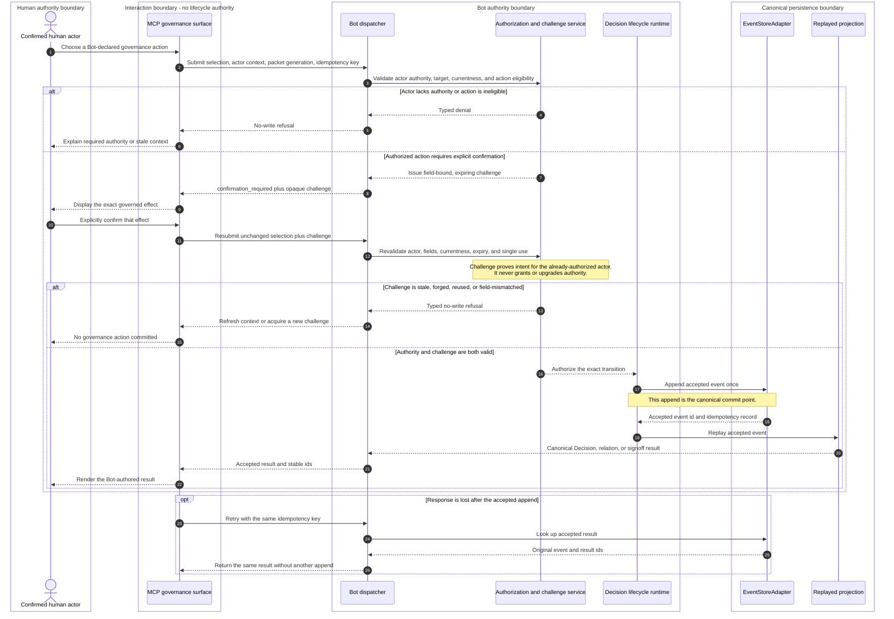

# Runtime Architecture: MCP-Mediated DecisionCandidate Conflict Resolution

Date: 2026-07-17

Status: accepted

Level: L2 cross-repository contract

Owns: the authority, persistence, routing, confirmation, replay, and recovery contract for the `mcp_active_work_recall_and_candidate_promotion` journey.

Related context: `docs/specs/mcp-mediated-candidate-conflict-resolution.md`; `BicameralAI/bicameral-mcp#733`; `BicameralAI/bicameral-bot#797`; `BicameralAI/bicameral-bot#823`; `BicameralAI/bicameral-bot#861`; `docs/domain/decision-lifecycle.md`; `docs/domain/runtime-protocol.md`; `docs/specs/default-signal-policy-v0.md`; `docs/specs/bot-mcp-data-flow-runtime-architecture.md`.

Governance gate: `bic:spec-governance-gate`; Qor advisory/no-op pending factory policy revision. `UserJourney`: `mcp_active_work_recall_and_candidate_promotion` plus included `mcp_decision_signoff`. Journey Boundary Review: **accepted by Jin on 2026-07-17**. The decision owner confirmed restart-invalidated alpha challenges, omission of candidate-to-signoff routing, direct signoff for accepted Decisions, omission of generic candidate accept/reject, inclusion of read-only governance inspection, the outcome-specific authority matrix, the alpha MCP action inventory, and supersession of the dashboard-only surface rule, and delegated the dismissal alpha inclusion decision to Kevin. Default dismissal behavior is typed unsupported unless an amended integrated contract is accepted.

## Reading Guide

Read `Runtime Invariant`, `Runtime State Classification`, `State Refinement Check`, and `Runtime Architecture Conformance` first.

Runtime invariant: **MCP may transport and render a human selection; only Bot may determine eligibility, validate confirmation and authority, append the accepted event, and replay the canonical result.**

The product has no separate Compliance / Compliance Review runtime axis. Bot and MCP must remove its state and command contracts, Integrations must remove its action token, and Cloud/dashboard bundles must be regenerated without it. Binding/evidence currentness, Decision signoff, and retrieval/signal concerns remain owned by their existing runtimes; organizational legal/security assurance remains outside this product runtime. The decision owner selected a clean incompatible cut on 2026-07-17: no migration, compatibility decoder, semantic remapping, or legacy action adapter is allowed. Old clients and legacy stores fail explicit protocol/store-version boundaries and never enter partially interpreted or writable operation.

## Conformance Gap Summary

Status vocabulary follows the runtime-conformance seed in PR #860: `proven` has cited implementation and executable evidence; `partial` has a real path but lacks this contract's complete boundary evidence; `missing` lacks the required implementation or witness; `unresolved` awaits its named owner.

| Conformance area | Status | Why |
| --- | --- | --- |
| Existing thin-client routing, candidate projection, event store, signoff, Binding, and evidence-refresh seams | `partial` | Reusable paths and conformance tests exist, but not the complete cross-boundary flow defined here. |
| Bot-derived evidence refresh | `proven` | Existing refresh and watcher evidence already establishes the no-governance-write boundary; only the MCP route witness remains partial. |
| ConfirmationChallenge, packet currentness, outcome-specific authority, replayable supersession/scope, restart/idempotent recovery | `missing` | Current promotion accepts presence-only proof and does not prove the required commit/recovery semantics. |
| Dismissal inclusion | `unresolved` | Kevin owns the inclusion decision; omission is the accepted alpha default. |
| Removal of generic candidate actions, tracking MCP mutations, contradiction transitions, correction requests, and the Compliance axis | `partial` or `missing` | Existing contracts still advertise or encode several removed paths; exact rows below name the evidence gap. |
| Claude Code and Codex terminal journeys | `missing` | Component tests are not terminal cross-process evidence. |

## Runtime Problem

The cross-repo flow names product outcomes without fully defining process authority or durable effects. The current Bot handler accepts a packet id without packet-store/currentness validation, checks only for approval-proof presence, omits supersession/scope values from accepted event semantics, and can return a signoff-route state without appending a route. This spec rejects that route: an unaccepted candidate cannot enter Decision signoff, so insufficient authority must be a typed no-write result.

## Goals And Non-Goals

This contract specifies one cross-process path: MCP presents Bot-declared governance actions, a human selects and confirms, Bot revalidates and appends, and replay exposes the result. It also fixes the alpha action inventory recorded by the feature proposal.

It does not assign MCP ranking, conflict interpretation, lifecycle, authorization, challenge validation, canonical event construction, or persistence. It does not introduce automatic supersession, candidate-to-signoff routing, persistent cross-device challenges, packet-local dismissal, or hidden retrieval suppression.

## Runtime Components

| Stable id | C4 kind / process | May | Must not |
| --- | --- | --- | --- |
| `ELM-HUMAN` | Person / confirmed human actor | Select and confirm an offered effect within existing authority | Rank candidates, make an ineligible action eligible, or delegate authority through a challenge |
| `ELM-HOST-MCP` | Container / Claude or Codex host plus MCP stdio | Render Bot order/actions, collect exact intent, relay, and retry by idempotency key | Author policy, validate proof, rerank, create events, or fall back locally |
| `ELM-DAEMON` | Container / Bot dispatcher | Route a typed request to the selected Product/store and return typed results | Trust caller proof presence or choose a store from cwd |
| `ELM-RECALL-AUTHZ` | Component / Bot recall, Signal Policy, and authorization seams | Rank/project candidates, declare eligible actions, validate actor/currentness, and issue/consume challenges | Persist Decisions or let relevance feedback become rejection authority |
| `ELM-DECISION` | Component / Bot Decision and Binding lifecycles | Construct the exact accepted transition after authorization | Delegate event meaning to MCP response text |
| `ELM-EVENTSTORE` | Datastore / selected EventStoreAdapter | Append accepted events and durable idempotency metadata | Accept direct surface writes |
| `ELM-PROJECTION` | Component / replayed read models | Reconstruct Decisions, relationships, signoff, Binding, and active contradiction views | Invent missing event semantics |
| `ELM-TRACE` | Datastore / runtime observability | Record redacted execution witnesses | Establish authority or canonical state |

## Runtime Relationships

| Stable id | Source -> destination | Handoff / boundary |
| --- | --- | --- |
| `REL-HOST-MCP` | `ELM-HUMAN -> ELM-HOST-MCP` | Interactive selection/confirmation crosses the human-to-automation authority boundary. |
| `REL-MCP-DAEMON` | `ELM-HOST-MCP -> ELM-DAEMON` | Typed local request crosses process/repository trust and carries no authority grant. |
| `REL-DECISION-EVENTSTORE` | `ELM-DECISION -> ELM-EVENTSTORE` | Accepted append crosses the canonical persistence boundary and is the commit point. |
| `REL-EVENTSTORE-PROJECTION` | `ELM-EVENTSTORE -> ELM-PROJECTION` | Replay crosses from accepted events into rebuildable read models. |

The governed route continues through `ELM-DAEMON -> ELM-RECALL-AUTHZ -> ELM-DECISION`; no edge may skip Bot authorization or the selected EventStoreAdapter.

## ConfirmationChallenge Across Authority And Persistence Boundaries

`ConfirmationChallenge` is a Bot-issued proof-of-intent handshake for an action that Bot has already found eligible for the identified actor. It crosses the MCP process boundary only as an opaque value for display/relay. It does not cross the authority boundary as a credential, delegation, role grant, or accepted event.

The diagram separates four facts that must not be collapsed:

| Artifact | What it establishes | What it cannot establish | Owner / retention |
| --- | --- | --- | --- |
| `AuthorityContext` plus Bot policy result | The identified actor currently has the authority required for this exact action class and target. | Explicit human intent, canonical mutation, or future authority after policy/target changes. | Bot authorization boundary; reevaluated on submission and confirmation. |
| `ConfirmationChallenge` | The already-authorized human explicitly confirmed the exact bound effect within its validity window. | Actor identity by itself, new/delegated authority, ranking correctness, event acceptance, or durable Decision state. | Bot-issued authorization scratch; single-use, short-lived, restart-invalidated in alpha. |
| Accepted event plus idempotency record | Bot accepted and committed the governed transition exactly once. | Projection freshness or successful delivery of the response to MCP. | EventStoreAdapter; durable and replayable. |
| Runtime trace or MCP receipt | Which processes and surface participated in the attempt. | Approval, authority, accepted state, or a substitute for event replay. | Operational observability only; redacted and retention-bounded. |

Therefore, the governance action requires **both** independently valid actor authority and a valid `ConfirmationChallenge`. Failure of either condition produces a typed no-write result. MCP may relay the challenge and retry the accepted request, but only Bot can validate it and only the accepted event can materialize the action.

## Runtime State Classification, Authority, Persistence, And Routing

| Stable id | Class | Authority / persistence | Release behavior |
| --- | --- | --- | --- |
| `STATE-CANDIDATE` | Candidate proposal | Bot-local candidate projection | MCP may render only a Bot-selected current candidate. |
| `STATE-PACKET` | Derived read envelope | Bot recall service; bounded cache/generation | Binds candidate order, conflicts, eligible actions, and currentness; restart invalidates it in alpha. |
| `STATE-CHALLENGE` | Authorization scratch | Bot authorization memory | Single-use, field-bound, short-lived, restart-invalidated; never grants authority. |
| `STATE-ACCEPTED-EVENT` | Canonical accepted event | Selected EventStoreAdapter | Sole commit point for promotion, supersession, scoped coexistence, signoff, and Binding actions. |
| `STATE-IDEMPOTENCY` | Durable accepted-result identity | EventStoreAdapter/event metadata | Same-key retry returns the original committed result, including after restart. |
| `STATE-DECISION` | Canonical Decision | Accepted event plus replay | New constraints create an unsigned Decision; revision preserves prior history. |
| `STATE-DECISION-RELATION` | Canonical relationship | Accepted event plus replay | Supersession retains old history; coexistence stores validated structured scope. |
| `STATE-SIGNOFF` | Canonical Decision signoff | Accepted event plus replay | Only an accepted Decision may be approved or rejected; rejection preserves identity/history. |
| `STATE-BINDING` | Canonical Binding evidence | Bot Binding lifecycle plus accepted event | Only an eligible, verified, current candidate may materialize through the accepted Binding path. |
| `STATE-RELEVANCE-FEEDBACK` | Deferred candidate proposal | No alpha owner or persistence | Exists only if Kevin accepts an amended Bot-owned Signal Policy/RAG contract. |
| `STATE-RUNTIME-TRACE` | Operational witness | Redacted Bot/MCP logs | Explains execution; never establishes authority or product state. |

## State Refinement Check

Smallest release states: packet issued, challenge required, challenge invalid/no-write, accepted event committed, replayed result available, and idempotent result recovered. Product effects remain existing Decision, signoff, Binding, and relationship state; MCP surface origin is metadata, not a lifecycle state.

Added behavior: `ConfirmationChallenge`, packet-generation validation, outcome-specific authority, durable supersession/scope fields, and durable accepted-result recovery.

Deferred: dismissal relevance feedback; asynchronous candidate `ReviewRequest`; cross-device challenge delegation. Removed rather than deferred: generic candidate accept/reject in MCP alpha, tracking mutations in MCP alpha, standalone contradiction transitions, `recall.request_correction`, candidate-to-signoff routing, and the Compliance product axis.

## State Minimization Review

- No `mcp_mediated`, generic `conflict_resolved`, `superseded_candidate`, packet-local dismissal, or response-only review state.
- Challenges remain ephemeral because accepted events and durable idempotency already own post-commit recovery.
- Contradiction visibility is derived from replay of substantive governance actions, not an independently mutable status.
- Dismissal stays absent unless its Signal Policy/RAG integration is scoped, attributable, inspectable, reversible, retention-bounded, and evaluated for false-negative feedback loops.

## Authority Ownership Matrix

| Verb | Human | MCP | Bot Recall | Bot authorization | Bot Decision runtime | Event store | Projection |
| --- | --- | --- | --- | --- | --- | --- | --- |
| Observe work/candidate | yes | relay/render | project | read selection | read target state | no | expose daemon-local candidate state |
| Rank candidates | no | forbidden | yes | no | no | no | render stored order |
| Propose eligible outcomes | no | forbidden | project from Bot policy/context | validate | no | no | render |
| Choose outcome | yes | relay | no | no | no | no | no |
| Issue/validate confirmation | confirm only | forbidden/relay only | no | yes | consume authorization result | no | no |
| Authorize transition | no | forbidden | no | yes | require authorization | no | no |
| Materialize | no | forbidden | no | no | construct accepted event | append | replay/project |
| Dismiss / provide negative relevance feedback | choose only if future action is offered | forbidden in default alpha; future relay only | omit action and return typed unsupported; future retrieval consumes Bot policy output | no default-alpha action | never treat feedback as Decision transition | no Decision event | future explainable ranking projection only |

## Runtime Scenarios

| Scenario id | Required observable result |
| --- | --- |
| `SCN-STARTUP` | MCP binds one compatible Bot/Product/store; incompatibility fails closed without local fallback. |
| `SCN-RECALL-SELECT` | Bot returns ranked current candidates and eligible actions; selection alone writes nothing. |
| `SCN-CONFIRM-COMMIT` | Bot validates actor/currentness, issues a bound challenge, consumes it once, appends once, and replay exposes the result. |
| `SCN-RESPONSE-LOSS` | Same-key retry after append returns the original result without a second event. |
| `SCN-DAEMON-RESTART` | Uncommitted packet/challenge state becomes stale; accepted results remain recoverable. |
| `SCN-DISMISS-DEFERRED` | Default alpha omits dismissal and compatibility calls create no preference, feedback, or candidate state. |
| `SCN-BINDING-GOVERNANCE-HANDOFF` | MCP presents only Bot-eligible Binding actions; bot#823 owns unresolved rejection/consent semantics. |
| `SCN-SIGNOFF-GOVERNANCE-HANDOFF` | Only an accepted Decision may enter approve/reject signoff; owner authority, challenge, event, and replay are required. |
| `SCN-GENERIC-CANDIDATE-DEFERRED` | Generic candidate accept/reject is absent from MCP alpha and direct calls append nothing. |
| `SCN-MCP-TRACKING-REFUSAL` | MCP tracking mutations are absent/no-write; bot#861 owns the dashboard journey. |
| `SCN-CONTRADICTION-PERSISTS-UNTIL-GOVERNANCE` | Warning remains active until replay proves a substantive linked governance action resolved the conflict. |
| `SCN-EVIDENCE-REFRESH-EXISTING` | MCP requests Bot-derived currentness; no challenge, governance event, or accepted-state mutation occurs. |
| `SCN-CORRECTION-ACTION-REMOVED` | `recall.request_correction` is absent; only an eligible specialized promotion may mutate state. |
| `SCN-GOVERNANCE-INSPECT` | Scoped Bot-authored state/provenance/actions render with typed partial/unknown caveats and no write. |
| `SCN-LEGACY-AXIS-CUT` | Old Compliance-axis clients/stores fail explicit version gates; no decoder or partial writable mode exists. |
| `SCN-FORBIDDEN-MCP-DECIDES` | Reranking, proof minting, lifecycle inference, or direct persistence by MCP fails closed. |

## User Journey Contract

Journey id/name: `mcp_active_work_recall_and_candidate_promotion`.

Entrypoint: staged active-work recall in Claude Code or Codex.

Observable success: host displays an accepted Bot result; replayed lookup shows the same Decision and relationship.

Scenario mapping: recall `SCN-RECALL-SELECT`; confirmation/commit `SCN-CONFIRM-COMMIT`; default-alpha dismissal refusal `SCN-DISMISS-DEFERRED`; recovery `SCN-RESPONSE-LOSS` and `SCN-DAEMON-RESTART`; forbidden path `SCN-FORBIDDEN-MCP-DECIDES`.

Boundary contracts: `REL-HOST-MCP`, `REL-MCP-DAEMON`, `REL-DECISION-EVENTSTORE`, and `REL-EVENTSTORE-PROJECTION`.

Required evidence: terminal Claude Code and Codex receipts, protocol contract fixtures, accepted event/replay assertion, restart/idempotency test, and no-local-fallback negative fixture.

Additional included UserJourney: `mcp_decision_signoff`.

- Entrypoint: an accepted unsigned Decision rendered in Claude Code or Codex.
- Observable success: Bot accepts approve/reject signoff exactly once and replay exposes the same `STATE-SIGNOFF` result.
- Scenario: `SCN-SIGNOFF-GOVERNANCE-HANDOFF`.
- Boundary contracts: `REL-HOST-MCP`, `REL-MCP-DAEMON`, `REL-DECISION-EVENTSTORE`, and `REL-EVENTSTORE-PROJECTION`.
- Required evidence: both-host terminal receipts, accepted signoff event/replay assertion, response-loss retry, and negative candidate-target/insufficient-authority fixtures.
- Journey Boundary Review: accepted on 2026-07-17; the numbered signoff walkthrough and terminal obligations are part of the accepted contract.

Journey Boundary Review: **accepted by the decision owner on 2026-07-17**. The accepted contract includes the topology, commit points, partial-success facts, safe retry, forbidden duplicate recovery, witness/product-state distinction, alpha MCP action inventory, restart-invalidated challenges, omission of candidate-to-signoff routing, the authority matrix, removal of the separate correction-request action, and supersession of the dashboard-only rule. MCP is a first-class governance and candidate-promotion surface while Bot retains policy, authority validation, and persistence. Dismissal alpha inclusion is delegated to Kevin with omission as the default. Terminal receipts remain required before release acceptance.

## Event, Command, And Protocol Contracts

| Stable transition | Contract |
| --- | --- |
| `TRANS-ISSUE-CHALLENGE` | Initial `recall.promote_decision_candidate` carries idempotency key, packet id/generation, candidate, selected outcome, required target/scope, actor context, selected Product/store, and protocol version. Bot returns a typed refusal, prior result, or `confirmation_required` with an opaque bound challenge. |
| `TRANS-PROMOTE-NEW` | Confirmed candidate-review actor creates one accepted unsigned Decision. |
| `TRANS-SUPERSEDE` | Confirmed owner-level actor creates the new Decision plus an explicit supersession relation; old history remains. |
| `TRANS-SCOPE-COEXIST` | Confirmed owner-level actor creates the new Decision plus validated structured scope relating both Decisions. |
| `TRANS-APPROVE-SIGNOFF` / `TRANS-REJECT-SIGNOFF` | Accepted Decision only; confirmed owner-level actor; append-only signoff result. |
| `TRANS-IDEMPOTENT-RETRY` | Same Product/store and idempotency key returns the original accepted event/result without append. |

`RecallPacket` must carry Bot-authored order, eligible actions, currentness/generation, routing identity, candidate/conflict/evidence references, required outcome fields, and protocol version. MCP may neither add actions nor treat enum presence as capability evidence.

The confirmed request must repeat the exact bound fields. Bot revalidates actor, action eligibility, packet/target currentness, expiry, single use, and routing before the accepted append. Arbitrary or presence-only `ApprovalProof` values are nonconforming.

| Failure | Required behavior |
| --- | --- |
| Incompatible daemon/client/store | Explicit version error; no fallback, decoder, partial projection, or writable mode. |
| Stale packet, candidate, target, or challenge | Typed no-write result and fresh recall/challenge where applicable. |
| Insufficient authority | `owner_authorization_required` plus inspection reference; no Decision, signoff, route, queue, or event. |
| Default-alpha dismissal | `unsupported_alpha`; no preference, relevance feedback, candidate mutation, or hidden RAG weight. |
| Append result uncertain | Resolve through same-key EventStore lookup before retrying; never infer success from MCP receipt. |
| Projection pending after accepted append | Return accepted event id plus typed projection status; never append again. |

Runtime traces retain redacted routing, request/idempotency, actor, packet/generation, candidate/outcome, challenge status, accepted event id, retry count, versions, and failure reason. Challenge secrets, source excerpts, model rationale, and unrelated work context are excluded. Only accepted events/replay establish product state.

## Substrate Capability Matrix

| Substrate | Canonical write | Policy/identity | Recovery |
| --- | --- | --- | --- |
| Claude/Codex host and MCP stdio | no | interactive context and relay only | retry same idempotency key; no local fallback |
| Bot daemon | through governed lifecycle runtime | validates routing, actor, currentness, and challenge | typed stale/unavailable results |
| EventStoreAdapter | accepted events only | append-time invariants | durable replay and idempotent lookup |
| Projection | no independent authority | none | rebuild from accepted events |

No hosted capability is required for the local alpha journey; cross-device challenges and team-wide review routing remain deferred.

## Deployment And Runtime Topology

Start the selected Bot daemon/store before MCP and the host session. Multiple hosts may address the same daemon, so challenge and idempotency validation stay in Bot. Working directory is never Product/store identity.

## Error, Retry, And Recovery Behavior

The failure table above is normative. Pre-commit failures write nothing; post-commit uncertainty resolves by durable idempotency lookup; restart invalidates ephemeral packet/challenge state but not accepted results.

## Observability, Audit, And Receipts

Redacted traces and host receipts are validation witnesses only. The accepted event id plus replayed projection is the product-state witness.

## Security, Privacy, And Authority Boundaries

MCP observes only authorized local context and opaque challenge material. Bot revalidates every bound field and actor authority. No challenge secret, source excerpt, model rationale, or unrelated work context enters accepted events or logs; negative conformance must cover forged, reused, cross-actor, cross-store, and field-mutated challenges.

## Runtime Architecture Conformance

This registry is the implementation handoff. Status and evidence follow PR #860; detailed assertions belong in the cited fixtures/tests and in issues that preserve these ids.

| ID / status | Source ids / owning seam | Required behavior; prohibited fallback | Current evidence | Missing validation or work |
| --- | --- | --- | --- | --- |
| `CONF-ROUTING-01` / `partial` | `ELM-HOST-MCP`, `REL-MCP-DAEMON`, `SCN-STARTUP`; MCP Bot-client seam | Selected Bot dispatcher only; no MCP-local, legacy, or cwd fallback. | `bot_mcp_thin_client_conformance.rs`; `multi_worktree_mcp_conformance.rs` | Both-host promotion fixture. |
| `CONF-PACKET-01` / `partial` | `STATE-PACKET`, `TRANS-ISSUE-CHALLENGE`, `SCN-RECALL-SELECT`; Recall/auth seam | Validate candidate, outcome, generation, target, Product/store; never trust packet id alone. | `alpha_recall_candidate_contract.rs`; `alpha_recall_candidate_path.rs` | Handler currentness and restart witness. |
| `CONF-AUTH-01` / `missing` | `STATE-CHALLENGE`, `TRANS-ISSUE-CHALLENGE`; challenge seam | Bot-minted, single-use, field-bound challenge; no MCP minting or presence-only proof. | Current `ApprovalProof` shape only. | Contract plus forged/reused/mutated/restart negatives. |
| `CONF-AUTH-02` / `partial` | `TRANS-PROMOTE-NEW`, `TRANS-SUPERSEDE`, `TRANS-SCOPE-COEXIST`; authorization seam | Candidate review may create new Decision; owner revision required for supersession/scope; challenge cannot elevate. | `action_authorization.rs`; `action_authorization_conformance.rs` | Outcome matrix and non-escalation evidence. |
| `CONF-AUTH-REFUSAL-01` / `missing` | `SCN-CONFIRM-COMMIT`; authorization/response seam | `owner_authorization_required` and no state; no response-only route or implicit review request. | None. | Typed response plus zero-event/zero-review-state test. |
| `CONF-PERSIST-01` / `partial` | `STATE-DECISION-RELATION`, `REL-DECISION-EVENTSTORE`; event/replay seam | Supersession/scope fields append and replay; no response-only or reason-string semantics. | `event_store_conformance.rs`; `projection_rebuild_conformance.rs` | Outcome event schemas and replay fixtures. |
| `CONF-RETRY-01` / `missing` | `STATE-IDEMPOTENCY`, `TRANS-IDEMPOTENT-RETRY`, `SCN-RESPONSE-LOSS`; dispatcher/store seam | Same key returns one accepted result; no process-only dedupe or second append. | Canonical append/replay exists. | Response-loss and durable lookup witness. |
| `CONF-RESTART-01` / `missing` | `STATE-PACKET`, `STATE-CHALLENGE`, `STATE-IDEMPOTENCY`, `SCN-DAEMON-RESTART`; daemon/store seam | Invalidate uncommitted state, preserve committed result; no orphaned challenge or lost acceptance. | None. | Before/after-commit restart topology test. |
| `CONF-DISMISS-DEFER-01` / `missing` | `STATE-RELEVANCE-FEEDBACK`, `SCN-DISMISS-DEFERRED`; capability seam | Omit default-alpha dismissal; no packet hide, MCP preference, candidate mutation, or hidden RAG weight. | Outcome vocabulary exists. | Capability omission and typed no-state refusal. |
| `CONF-DISMISS-INTEGRATION-01` / `unresolved` | `STATE-RELEVANCE-FEEDBACK`; Signal Policy/RAG seam | If included, Bot-owned scoped, inspectable, reversible feedback; no global/unscoped suppression. | None; omission is default. | Kevin decision, amended contract, retrieval evaluation. |
| `CONF-BINDING-HANDOFF-01` / `partial` | `STATE-BINDING`, `SCN-BINDING-GOVERNANCE-HANDOFF`; MCP/Binding seam | Only Bot-eligible/current actions reach canonical Binding; no MCP eligibility/materialization. | `binding_alpha_path_conformance.rs`; `binding_dispatch_conformance.rs`; bot#823 | Consent/rejection contract and terminal witness. |
| `CONF-SIGNOFF-HANDOFF-01` / `partial` | `STATE-SIGNOFF`, `TRANS-APPROVE-SIGNOFF`, `TRANS-REJECT-SIGNOFF`, `SCN-SIGNOFF-GOVERNANCE-HANDOFF`; MCP/Decision seam | Accepted Decision, owner authority, challenge, append/replay/retry; no candidate route or response-only approval. | Existing signoff protocol/authorization paths. | MCP fixtures, restart/replay, both-host journey. |
| `CONF-GENERIC-CANDIDATE-DEFER-01` / `partial` | `STATE-CANDIDATE`, `SCN-GENERIC-CANDIDATE-DEFERRED`; capability/dispatcher seam | Omit generic candidate accept/reject; no local fallback or generic rejection event. | Specialized RecallPacket promotion exists. | Capability and dispatcher negatives. |
| `CONF-TRACKING-DASHBOARD-ONLY-01` / `partial` | `SCN-MCP-TRACKING-REFUSAL`, bot#861; capability/tracking seam | MCP omits tracking writes; dashboard presents journey, Bot persists; no hidden MCP job/fallback. | `alpha_capability_advertising_conformance.rs` | MCP no-write witness and accepted dashboard journey. |
| `CONF-CONTRADICTION-DERIVED-RESOLUTION-01` / `missing` | `SCN-CONTRADICTION-PERSISTS-UNTIL-GOVERNANCE`, `STATE-ACCEPTED-EVENT`, `ELM-PROJECTION`; preflight/replay seam | Clear only after linked substantive governance event; no acknowledge/dismiss/mark-resolved control. | Existing findings. | Command removal plus linked/unrelated-event and history fixtures. |
| `CONF-EVIDENCE-REFRESH-HANDOFF-01` / `partial` | `SCN-EVIDENCE-REFRESH-EXISTING`; MCP/GraphSnapshotService seam | Return Bot-derived currentness with no challenge/event/canonical mutation; no MCP computation. | Bot side proven by `evidence_refresh_conformance.rs`, #646, #657. | MCP route and zero-write fixture. |
| `CONF-CORRECTION-ACTION-REMOVAL-01` / `missing` | `SCN-CORRECTION-ACTION-REMOVED`; protocol/capability seam | Omit `recall.request_correction`; no legacy handler, queue, request, or event. | Current capability advertises support. | Removal plus legacy-call negative. |
| `CONF-GOVERNANCE-READ-01` / `partial` | `SCN-GOVERNANCE-INSPECT`; MCP/projection seam | Scoped Bot-authored state/provenance/actions with honest caveats; no inference or append. | `api/src/governance.rs`; `runtime/src/governance.rs` | Scope, partial/unknown, no-event, no-inference fixtures. |
| `CONF-LEGACY-AXIS-REMOVAL-01` / `missing` | `SCN-LEGACY-AXIS-CUT`; cross-repo protocol/generation seam | Remove Compliance state/action/token and fail old versions; no decoder, remap, or stale bundle. | Active code still contains axis. | Cross-repo removal, regenerated artifacts, incompatible receipts. |
| `CONF-FORBIDDEN-01` / `partial` | `ELM-HOST-MCP`, `SCN-FORBIDDEN-MCP-DECIDES`; MCP boundary | Render exact Bot order/actions and fail closed; no rerank, authority inference, proof mint, or persistence. | Thin-client and negative recall fixtures. | Both-host promotion negative. |
| `CONF-JOURNEY-01` / `missing` | `REL-HOST-MCP`, `REL-MCP-DAEMON`, `REL-DECISION-EVENTSTORE`, `SCN-CONFIRM-COMMIT`, `SCN-RESPONSE-LOSS`; cross-repo seam | Both hosts reach the same replayed result; component tests are not terminal proof. | None. | Real-process Claude and Codex receipts with event/replay correlation. |

## Implementation Sequencing

Issue slicing is by conformance boundary, not document section:

1. Bot packet/currentness, challenge, outcome authority, and no-write refusal.
2. Bot accepted events, replayable relationships, durable idempotency, and restart recovery.
3. Capability removals and the clean incompatible cut across Bot, MCP, Integrations, and generated artifacts.
4. MCP Claude Code and Codex thin adapters with no fallback.
5. Binding and dashboard tracking only after bot#823 and bot#861 settle their owned journey details.
6. Terminal candidate-promotion and accepted-Decision signoff journeys; component CI cannot substitute for these receipts.

Every issue must cite its `CONF-*` rows and advance their status only when the cited executable evidence exists.

## Issue Generation Notes

Use the six tracer bullets above. Hard gates are bot#823 for Binding semantics, bot#861 for the dashboard tracking journey, Kevin's amended contract only if dismissal is included, and `CONF-JOURNEY-01` for release acceptance. Preserve all stable ids.

## Acceptance Criteria

This runtime contract is accepted when every in-scope `CONF-*` row is `proven`, every prohibited fallback has executable negative evidence, accepted outcomes reconstruct from replay without MCP receipts, and both terminal hosts demonstrate the same commit/retry behavior. `unresolved` rows must be omitted from capability rather than treated as implemented.

## Validation Plan

Run the concrete tests/fixtures cited by the conformance registry, add the missing witnesses named there, then execute both real-process terminal journeys. Component, contract, attestation, and diagram evidence cannot replace `CONF-JOURNEY-01`.

## ADR Implications

- Supersede ADR-0024 only where it makes dashboard the exclusive governance/conflict surface or retains a separate correction request; preserve read-only recall and Bot-owned materialization.
- Supersede standalone contradiction transitions in ADR-0011/authenticated-governance specs; preserve finding visibility, authority, and history.
- Reaffirm the Bot-MCP thin-client boundary and append-only Decision history.
- Signal Policy v0 remains unchanged while dismissal is omitted; inclusion requires an amendment.
- Durable or cross-process challenges would cross the accepted persistence/security boundary and require a new ADR.

## Open Questions

Kevin owns the delegated dismissal inclusion decision, with omission as the accepted default. As lifecycle author he also owns the exact challenge TTL, structured scope schema, event versions, typed failures, and incompatible-cut release mechanics. bot#823 and bot#861 remain the named lifecycle/journey gates; no Jin publication blocker remains.

## Request Coverage

Product scope and lifecycle ownership live in the feature proposal. This runtime document owns the authority/persistence flow, `ConfirmationChallenge` diagram, stable scenario/transition ids, status-bearing conformance registry, and implementation evidence gaps.
