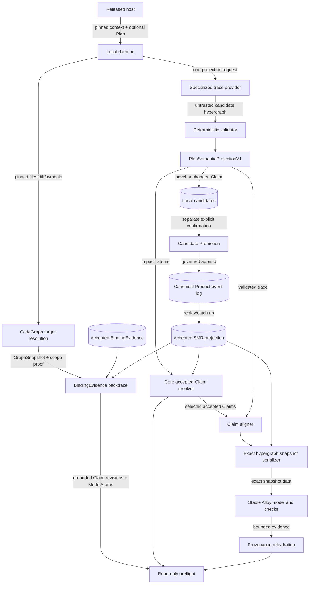

# TDD — SMR Alpha Managed Preflight

## Document metadata

| Field | Value |
|---|---|
| Product | Bicameral |
| Core flow | Independent deterministic grounded recall plus exact-Plan deep semantic analysis |
| Status | Draft regenerated for implementation |
| Date | 2026-07-30 |
| Product owner / technical lead | `@jinhongkuan` |
| Owner boundary decision | [Bot #967 REVISE disposition](https://github.com/BicameralAI/bicameral-bot/issues/967#issuecomment-5124918725) |
| Companion bridge design | Sections 3 and 9–14 summarize the normative algorithm detailed in [`smr-alpha-claim-semantic-trace-alloy-bridge.md`](smr-alpha-claim-semantic-trace-alloy-bridge.md) and its machine-readable contract |
| Companion validation design | Section 18 summarizes the prototype boundary and evidence detailed in [`smr-alpha-minimal-honest-test-harness.md`](smr-alpha-minimal-honest-test-harness.md) |
| Normative journey | [`smr-alpha-managed-preflight-user-journeys.md`, J1](smr-alpha-managed-preflight-user-journeys.md#j1---managed-preflight) |
| Normative SMR result | [`smr-alpha-runtime-contract.md`, Result Shape](smr-alpha-runtime-contract.md#result-shape) |
| Existing SMR runtime | [Runtime architecture, base commit `faa26c3`, Command Boundary](https://github.com/BicameralAI/bicameral-bot/blob/faa26c3c88ef8d8acc598cf0542917a7759f27cd/docs/specs/state-machine-resolver-v1-runtime-architecture.md#3-command-boundary) |
| Canonical QA catalog | [`developer_host_mcp_v1`, Factory commit `1af42ea`, lines 397–415](https://github.com/BicameralAI/bicameral-factory/blob/1af42eaeb7a87e40d17acc989a6a55fa830522b1/docs/architecture/bicameral-product/journey-environments.json#L397-L415) |
| Governance | `bic:spec-governance-gate`; Qor advisory/no-op |
| Roadmap | Bicameral Factory #346 |

## 1. Executive summary

SMR Alpha Managed Preflight returns two independently observable read-only
results. The deterministic grounded-recall lane may return first for a pinned
workspace and head without invoking an LLM. The deep semantic lane converts one
exact developer Plan into `PlanSemanticProjectionV1`, retrieves accepted Claims
from impacted ModelAtoms, and runs bounded semantic analysis. Neither lane
waits for, relabels, or supplies authority to the other.

```text
Lane A - deterministic grounded recall
  pinned Product/workspace/head + diff/files/symbols
    -> deterministic CodeGraph target resolution
    -> accepted BindingEvidence backtrace
    -> exact accepted Claim revisions and ModelAtoms
    -> daemon-authored read-only grounded result

Lane B - deep semantic analysis
  exact Plan
    -> PlanSemanticProjectionV1
         -> ClaimSemanticTraceV1 candidate hypergraph
         -> impact_atoms
         -> optional proposed Claim set
    -> deterministic impacted-ModelAtom -> accepted-Claim retrieval
    -> assertion-level accepted-Claim alignment
    -> SmrCheckScopeAssessmentV1
    -> complete accepted + proposed alpha-domain snapshot
    -> stable smr-meta-model.als + smr-checks.als
    -> bounded semantic result mapped to accepted Claims and Plan spans
```

The LLM never writes Alloy. It proposes the candidate hypergraph.

The serializer does not decide which semantic neighborhood matters. Alpha
projects the complete bounded Candidate Promotion hypergraph and uses exact
Alloy bounds.

The canonical Product event log remains authoritative. The accepted SMR
hypergraph is its rebuildable semantic projection; Alloy is a temporary
analysis snapshot.

CodeGraph is required only for the independently release-validatable grounded
lane in configured workspaces. It remains unnecessary for SMR semantic
correctness and bounded Alloy acceptance. Code applicability at one pinned
GraphSnapshot is not currentness, implementation correctness, compliance,
approval, safety, or an all-clear.

## 2. Product problem

SMR Alpha prevents unnoticed Plan-time semantic drift:

> A Plan changes, contradicts, broadens, narrows, or bypasses accepted Product
> semantics without making the difference visible before implementation.

Impact atoms alone are insufficient:

```text
Reviewer recommends promotion.
Reviewer approves promotion.
Product Owner approves promotion.
```

The same atom neighborhood can express different authority.

A relational candidate hypergraph preserves:

- actor;
- action;
- target;
- modality and polarity;
- quantifier;
- lifecycle source and destination;
- guard and effect;
- ordering and branches;
- exceptions and unknowns.

Alloy then complements the LLM by exploring small relational and temporal
combinations.

## 3. Design decisions

### 3.1 Relational trace beneath the impact-atom contract

`PlanSemanticProjectionV1` is the journey and runtime boundary.
`ClaimSemanticTraceV1` is its deeper local relational representation.
`impact_atoms` are deterministically derived from the validated trace and
remain mandatory contract output for accepted-Claim retrieval.

### 3.2 Full alpha-domain projection

Alpha serializes every supported accepted and proposed record in the bounded
Candidate Promotion domain.

No intelligent slicer or generic Claim-family compiler ships in alpha.

### 3.3 Stable hand-written Alloy semantics

Stable source files own semantics:

```text
smr-meta-model.als
smr-checks.als
```

Per analysis, the bridge supplies exact hypergraph data and a named bounded
check. It does not generate a new semantic program.

### 3.4 Read-only formal evidence

An Alloy instance, counterexample, unsat result, or no-counterexample result is
bounded evidence. It is not accepted Product truth, compliance, approval, or a
universal all-clear.

### 3.5 Independent grounded and semantic lanes

The deterministic grounded lane starts from pinned code context and returns
accepted BindingEvidence backtrace results without Plan extraction. The deep
semantic lane validates Plan semantics against accepted Product semantics
without CodeGraph. When both lanes participate, they bind the same requested
Product, workspace, and head context, but each preserves its own result,
limitations, scope proof, and completion milestone.

`ScopeSufficiencyProof` belongs only to bounded code/graph coverage.
`SmrCheckScopeAssessmentV1` belongs only to business-logic sufficiency for one
named bounded Alloy check. They must not be collapsed into one
`scope_sufficient` flag.

## 4. Goals

- Capture one exact final Plan.
- Project one immutable source-grounded candidate hypergraph.
- Preserve mixed, branching, and ambiguous Plan semantics.
- Align every assertion independently with accepted Claims.
- Project the complete supported alpha domain into Alloy.
- Use exact bounds so Alloy cannot invent extra snapshot records.
- Run stable authorization, lifecycle, invariant, precedence, and reachability
  checks.
- Reverse-map every finding to stable hypergraph and source IDs.
- Preserve retry/restart identity.
- Return deterministic grounded recall without waiting for ClaimTrace.
- Record graph preparation, warm recall, time to first grounded result, and
  deep-analysis completion separately.
- Keep preflight read-only.
- Retain separate explicit Candidate Promotion.

## 5. Non-goals

- General NL-to-formal compilation.
- LLM-authored Alloy.
- Generic slicing or generic lowering.
- Unbounded verification.
- Complex liveness, fairness, deadlines, or concurrency.
- Code correctness or compliance.
- CodeGraph as a prerequisite for deep semantic analysis or bounded Alloy.
- BindingEvidence as proof of compliance, currentness, approval, or safety.
- Automatic acceptance.
- Alloy as canonical storage.

## 6. Alpha domain and checks

### Domain

```text
States: Proposed, Accepted, Rejected
Actors: Reviewer, Product Owner
Actions: Recommend, Approve, Reject
```

### Supported Claims

- authorization and prohibition;
- lifecycle source, guard, effect, destination;
- invariants and cardinality;
- simple precedence and exclusive branches;
- reachability.

### Stable checks

1. accepted Claims plus Plan satisfiability;
2. unauthorized governed transition;
3. invalid or skipped lifecycle transition;
4. intended-outcome reachability.

### Initial bounds

`alloy-alpha-v1` uses no more than five atoms per top-level signature by
default and one through eight represented steps. Actual bounds are always
rendered.

The complete supported snapshot must fit those configured bounds. If it does
not, preflight returns `capacity_exceeded`. It must not truncate, slice, or
silently raise the bound. A later version may raise a reviewed capacity or add
a slicer checked against the complete-projection reference.

## 7. Integrated user journey and authority

The [managed-preflight journey contract, Normative Ordering and
Authority](smr-alpha-managed-preflight-user-journeys.md#normative-ordering-and-authority)
controls this section.

Claim Proposal and read-only Preflight are two runtime stages of one developer
journey. They retain separate command and authority semantics, but the user
does not make a second gesture between them. Candidate Promotion remains a
separate journey because it requires explicit confirmation and may append
canonical Product history. Within read-only Preflight, grounded recall and deep
semantic analysis are independent result lanes rather than serial gates.

```text
Pinned Product/workspace/head + completed planning turn
                 |
          +------+------+
          |             |
          v             v
+------------------+  +----------------------------------------+
| LANE A           |  | LANE B / STAGE A                       |
| GROUNDED RECALL  |  | PLAN SEMANTIC PROJECTION               |
|                  |  |                                        |
| CodeGraph target |  | exact Plan capture + local ingest      |
| -> accepted      |  | -> ClaimSemanticTraceV1                |
| BindingEvidence  |  | -> impact_atoms + optional proposal    |
| -> Claim/Atoms   |  +-------------------+--------------------+
+--------+---------+                      |
         | first grounded result          v
         |                     +--------------------------------+
         |                     | LANE B / STAGE B               |
         |                     | DEEP SEMANTIC ANALYSIS         |
         |                     |                                |
         |                     | accepted-model alignment       |
         |                     | -> semantic scope assessment   |
         |                     | -> bounded stable Alloy checks |
         |                     +----------------+---------------+
         |                                      |
         +-------------------+------------------+
                             v
                  daemon-authored read-only result
                    with independent lane status
                             |
                 candidate requires review?
                      |              |
                     no             yes
                      |              v
             developer continues   J2 Candidate Promotion
                                      |
                           canonical disposition append
                                      |
                             refreshed preflight
```

### 7.1 J1 — Managed Preflight

```yaml
user_journey:
  id: developer_host_mcp_smr_managed_preflight_v1
  name: SMR Managed Preflight
  actor: product_participant_using_a_coding_agent
  entrypoint: pinned_work_context_with_optional_completed_plan_capture
  success_state: independent_grounded_and_semantic_lane_status_visible
  surfaces:
    - released_developer_host
    - managed_mcp_surface
    - local_bot_daemon
  boundary_contracts:
    - PlanningContextSnapshotV1
    - accepted BindingEvidence
    - ScopeSufficiencyProof
    - SmrCheckScopeAssessmentV1
    - ingest.submit_local
    - smr.claims.propose
    - preflight.run
    - RecallPacket
  required_evidence:
    - producer_consumer_contract_tests
    - real_process_plan_hook_test
    - real_process_fast_grounded_recall_test
  canonical_mutation: none
```

#### 7.1.1 Exact Plan capture

Managed Preflight consumes one `PlanningContextSnapshotV1`, not a repository
spec file and not the full coding-agent transcript:

```yaml
PlanningContextSnapshotV1:
  source_kind: planning_context_v1
  product_id: string
  host_kind: claude_code | codex
  host_session_id: string
  host_turn_id: string
  capture_event: claude_exit_plan_mode | codex_plan_turn_complete
  final_plan_text: string
  content_digest: sha256:<lowercase-hex>
  repository_context: optional_advisory_object
```

The source identity is:

```text
(product_id, source_kind, host_kind, host_session_id, host_turn_id,
 content_digest)
```

Capture is host-specific:

- Claude Code consumes the successful `PostToolUse` event for `ExitPlanMode`
  and captures the exact approved `tool_response.plan`.
- Codex joins the Plan-mode `Stop` event to the matching
  `agent-turn-complete` notification by session and turn identity, then
  captures the exact `last-assistant-message`.
- The adapter must not scrape an unstable transcript, concatenate intermediate
  messages, or ingest user/tool chatter.
- `repository_context` is an advisory retrieval input. It is not source
  identity, Product authority, or implementation proof.
- If the exact event join is unavailable, capture is incomplete and the
  journey must not claim proposal coverage.

#### 7.1.2 Stage A — Plan Semantic Projection

The managed surface orchestrates capture, `ingest.submit_local`, and
`smr.claims.propose`. The complete analysis key extends source identity with:

```text
accepted SMR base position
accepted SMR base digest
extraction profile digest
```

The stage returns one `PlanSemanticProjectionV1`:

```yaml
PlanSemanticProjectionV1:
  analysis_key: sha256:<source identity + accepted SMR base + extraction profile>
  source_binding_digest: sha256:<PlanningContextBinding>
  accepted_smr_base_position: integer
  accepted_smr_base_digest: sha256:<accepted Claim projection>
  impact_atoms:
    - model_atom_id: daemon-verified identity
      normalized_semantics: typed atom tuple
      source_anchors: [plan span or explicit target]
      confidence: exact | strong | exploratory
  proposal_outcome: candidate_projected | no_candidate | incomplete
  proposed_claim_set: optional SmrClaimSetProposalV2
  coverage_limitations: []
  provider_provenance: caller | local
```

Alpha uses the versioned task profile `smr-claim-trace-alpha-v1`. It does not
hard-code a vendor model. The existing caller/local provider boundary remains
normative: a caller LLM or configured local `ClaimExtractionProvider` may run
the profile; hosted execution and silent provider fallback remain disabled.

Every analysis must nevertheless bind one exact extractor identity:

```yaml
ExtractionProfileV1:
  profile_id: smr-claim-trace-alpha-v1
  placement: caller | local
  provider_id: explicit adapter/provider identity
  model_id: exact provider model identity
  prompt_template_id: smr-claim-trace-alpha-v1
  output_schema_id: ClaimSemanticTraceV1
  decoding_profile_id: strict-structured-output-v1
  provider_config_digest: sha256:<normalized non-secret configuration>
```

`default`, `latest`, an omitted model identity, or an adapter that cannot
report the model it used is not an alpha profile. It returns
`unsupported_extraction_profile` before semantic projection. The decoding
profile requires schema-constrained structured output, one candidate
hypergraph, no model tools, and sampling disabled where the provider exposes
that control. The receipt records unsupported or provider-fixed decoding
controls instead of pretending determinism.

Specialization is therefore the reviewed task/prompt/schema/decoding profile,
not a claim that one vendor model is canonical. Changing any profile field
changes the analysis key and prevents cached-result reuse.

For this design, bounded whole-Plan enrichment first constructs and validates
`ClaimSemanticTraceV1`; `impact_atoms` and any proposed Claim set are derived
from that trace. This is an internal implementation refinement of
`PlanSemanticProjectionV1`, not a replacement wire result.

The enrichment runs once per analysis key. Stage B consumes that completed
projection and must not invoke a second LLM to reinterpret the same Plan.
Repeated hook firing for unchanged source bytes and analysis inputs reuses
`candidate_projected` or `no_candidate`; it must not create another candidate
generation.

The extractor may place multiple related Claims in one candidate. It partitions
only genuinely disconnected behavioral scopes—not sentences, paragraphs,
chunks, source spans, or provider-output items. Every candidate remains
daemon-local, disposable, and noncanonical until the separate promotion
journey.

#### 7.1.3 Stage B — Independent Read-Only Preflight Results

`preflight.run` first catches the local accepted-SMR projection up to canonical
Product history. A catch-up failure returns `model_unavailable`; it must not
return an empty or stale model as success.

Lane A does not wait for Stage A:

```text
pinned workspace/head + diff/files/symbols
  -> deterministic CodeGraph target resolution
  -> accepted BindingEvidence backtrace
  -> exact accepted Claim revisions and ModelAtoms
  -> grounded recall result
```

The daemon, not CodeGraph or MCP, resolves the inverse
code-target -> BindingEvidence -> Claim/ModelAtom relationship. Every match
retains the exact repository, head, GraphSnapshot, binding identity, Claim
revision, ModelAtom identity, match reason, searched scope, unknown coverage,
and code `ScopeSufficiencyProof`. Missing, stale, partial, ambiguous,
unsupported, unavailable, or incompatible graph evidence is a typed Lane A
limitation. It never becomes a scored miss and never blocks Lane B.

Lane B accepted-Claim retrieval is deterministic after Stage A:

```text
Plan impact atoms
  -> exact normalized accepted-ModelAtom overlap
  -> bounded typed accepted-atom relation closure
  -> reverse join ModelAtom -> accepted Claims
  -> rank and retain typed selection reason
```

The validated relational trace may then align those accepted Claims and the
supported alpha domain into the exact bounded Alloy snapshot described in
sections 9–14. Before an absence-sensitive Alloy conclusion, the daemon emits
`SmrCheckScopeAssessmentV1` for that named check. Alloy evidence is additional
read-only analysis. It does not replace impact-atom retrieval, construct
Claims, or supply Product authority.

Every result distinguishes:

```text
grounded recall      accepted code-applicability backtrace
accepted Claim       canonical Product history
unaccepted candidate local working proposal
bounded Alloy result derived analysis evidence
```

Every selected Claim retains the contributing impact atom, accepted ModelAtom
or relation path, route, and confidence. Missing projection coverage, missing
closure, unsupported semantics, and bounded or unsearched routes remain
visible. A sparse result, `no_candidate`, or no Alloy counterexample must never
be rendered as corpus completeness, implementation compliance, or all-clear.

`no_candidate` means only that no novel or changed Claim was proposed.
Successful semantic projection still returns its `impact_atoms` field and
continues through read-only accepted-Claim recall.

The daemon records these milestones independently:

```text
graph_preparation_ms
warm_grounded_recall_ms
time_to_first_grounded_result_ms
deep_semantic_analysis_ms
```

MCP renders each daemon-authored lane and milestone without recomputation. The
host must be able to show the Lane A result while Lane B remains pending.

### 7.2 J2 — Candidate Promotion

```yaml
user_journey:
  id: developer_host_mcp_smr_candidate_promotion_v1
  name: Candidate Promotion
  actor: authenticated_product_member
  entrypoint: unaccepted_candidate_shown_by_preflight_or_recall
  success_state: canonical_receipt_and_refreshed_recall_show_selected_outcome
  surfaces:
    - managed_mcp_surface
    - local_bot_daemon
    - canonical_product_event_store
  boundary_contracts:
    - recall.promote_decision_candidate
    - ConfirmationChallengeV2
    - claim_set_candidate_promoted
    - claim_set_candidate_rejected
  required_evidence:
    - producer_consumer_contract_tests
    - restart_replay_test
    - real_process_candidate_promotion_test
  canonical_mutation: governed append or durable rejection
```

The member reviews the exact candidate evidence, behavioral scope, Claim set,
and declared effect, then explicitly confirms one eligible outcome for that
candidate generation.

Promotion atomically appends the self-contained Claim set and creates
`Decision(approved)`. Its Claims become canonical, recallable, and
authoritative. Rejection appends the durable non-claim-bearing rejection
event and adds nothing to the effective Claim projection. Alpha skips a
later owner `approve_signoff` on this path. Every current Product
participant is Product Owner for this alpha cut.

After append, the daemon reconciles candidate working state, catches up or
rebuilds the SMR projection from canonical history, and reruns read-only
preflight. A lost response is recovered by retrying the same bound
`operation_id`; recovery must not append a second terminal disposition.

### 7.3 Planning-context machine-contract seam

The merged `SmrClaimSetProposalV1` accepts `ArtifactBinding`, which cannot
honestly encode a planning-session message. Full planning-context conformance
therefore requires:

```text
SmrClaimSetProposalV2
  source_binding =
    artifact_v1(ArtifactBinding)
    | planning_context_v1(PlanningContextBinding)

ConfirmationChallengeV3.proposal_identity
  binds source_binding_digest instead of artifact_binding_digest
```

`PlanningContextBinding` contains the source-identity fields plus
`content_digest`. Digest profile V2 domain-separates `source-binding` and
preserves the independent Claim-set, SMR-base, scope, evidence, and
confirmation digests. V1/V2 proposal and V2/V3 confirmation mismatches fail
closed; the daemon must not translate them implicitly.

Until that amendment lands, an isolated implementation may validate capture,
trace extraction, impact atoms, candidate staging, read-only preflight,
promotion, retry, and replay, but must report planning-context envelope and
digest conformance as unverified.

### 7.4 Commit points, retries, and forbidden recovery

| Boundary | Observable result | Correct continuation | Forbidden recovery |
|---|---|---|---|
| Exact Plan capture incomplete | Proposal coverage unavailable | Repair host event join and retry the same turn | Scrape transcript or guess final Plan |
| Trace extraction or validation incomplete | Accepted-model recall may continue with explicit limitation; bounded Plan conclusion unavailable | Repair provider/validation and retry the same analysis key | Manufacture fallback semantics or imply complete coverage |
| Repeated unchanged hook | Existing projection/candidate or `no_candidate` reused | Continue Stage B | Create duplicate generation |
| Alloy unavailable, timed out, or unverifiable | Formal evidence unavailable | Retry same pinned snapshot/analyzer or return recall without formal conclusion | Report no gap, safety, or compliance |
| Candidate disposition committed but response lost | Client outcome initially ambiguous | Retry same bound operation and return canonical receipt | Append another terminal disposition |
| Accepted projection cannot catch canonical head | `model_unavailable` | Replay/catch up, then rerun | Return stale or empty accepted model |

Authoritative commit points are:

1. planning-source evidence ingest;
2. daemon-local candidate staging;
3. canonical candidate-disposition append.

Only the third changes canonical candidate disposition or the accepted Claim
projection. Source ingest may persist eligible evidence through its existing
authority path; trace, alignment, exact snapshot, Alloy execution, and
preflight rendering remain independently observable evidence or projections.

### 7.5 Journey Boundary Review

```yaml
journey_boundary_review:
  status: passed
  journey_ids:
    - developer_host_mcp_smr_managed_preflight_v1
    - developer_host_mcp_smr_candidate_promotion_v1
  authoritative_commit_points:
    - planning_source_evidence_ingest
    - local_candidate_stage
    - canonical_candidate_disposition_append
  independently_observable_facts:
    - deterministic_grounded_recall_result
    - grounded_recall_scope_and_latency
    - exact_plan_snapshot
    - deep_semantic_analysis_outcome
    - local_candidate_generation
    - read_only_preflight_result
    - canonical_candidate_disposition
    - caught_up_smr_projection
  partial_failure_reviewed: true
  retry_and_idempotency_reviewed: true
  validation_witness_separated_from_product_state: true
  user_confirmed: true
  source_ref: docs/specs/smr-alpha-managed-preflight-user-journeys.md#journey-boundary-review
```

The bridge introduces no additional user journey or Product state.

## 8. Runtime architecture



### Components

| Component | Owns | Must not own |
|---|---|---|
| Host/MCP | Exact capture, request transport, and rendering | Semantic or code applicability inference |
| CodeGraph | Pinned target resolution and graph scope evidence | Claim selection, compliance, or Product authority |
| Grounded-recall resolver | Accepted BindingEvidence backtrace to exact Claim revisions and ModelAtoms | Treat applicability as currentness or compliance |
| Trace provider | Candidate hypergraph proposal | Alloy or authority |
| Validator | Structure and source spans | Semantic repair |
| Projection adapter | Derive daemon-verified `impact_atoms` and proposal outcome | Accept Claims or invent source identity |
| Core resolver | Exact atom overlap, bounded typed relations, reverse accepted-Claim join | Invoke a second Plan-interpreting LLM |
| Claim aligner | Retrieval and per-assertion comparison | Forced equivalence |
| Snapshot serializer | Structural isomorphism and provenance | Semantic selection |
| Stable Alloy model/checks | Reviewed relation semantics | Product authority |
| Analyzer | Bounded search | Universal proof |
| Accepted SMR projection | Rebuildable accepted semantic read model | Serve as canonical event authority |
| Canonical Product event log | Sole accepted-Claim and disposition commit point | Be rewritten by preflight or bridge analysis |

## 9. Hypergraph-to-Alloy model

The accepted SMR hypergraph contains:

- `ModelAtom`;
- `ClaimAssertion`;
- Claim membership hyperedges;
- `AtomRelation`;
- acceptance and source provenance.

The Plan candidate hypergraph contains:

- occurrences;
- assertions;
- ordering/branch edges;
- canonical mappings and alternatives;
- exact source spans;
- unknown dimensions.

The serializer emits a structurally exact Alloy representation of both.
Governed Claim hyperedges are reified so each `ClaimAssertion` remains
independently traceable.

Exact scope and relation equalities close the serialized snapshot. This means
Alloy cannot invent additional records. It does not mean missing Product
knowledge becomes false.

Completeness-sensitive checks require explicit accepted closure Claims.
Otherwise the result includes `unknown_scope`.

Every named bounded check also requires:

```text
SmrCheckScopeAssessmentV1 {
  source_scope
  source_coverage
  accepted_smr_base_position
  accepted_smr_base_digest
  included_claim_revisions[]
  included_model_atoms[]
  included_relations[]
  supported_semantic_dimensions[]
  unknown_semantic_dimensions[]
  required_closure_claims[]
  snapshot_cardinalities
  snapshot_digest
  check_id
  exact_bounds
  status:
    sufficient_for_named_bounded_check
    | insufficient
    | unknown_scope
}
```

A grounded counterexample may remain meaningful under partial scope. A
`no_counterexample_within_scope` or unsat-style conclusion requires
`sufficient_for_named_bounded_check` for that exact check. This semantic
assessment is independent from the CodeGraph `ScopeSufficiencyProof`.

## 10. Claim Semantic Trace contract

```text
ClaimSemanticTraceV1 {
  trace_id
  source_binding
  accepted_model_base
  extraction_profile: ExtractionProfileV1

  occurrences[] {
    occurrence_id
    kind
    source_unit_refs[]
    source_spans[]  # resolved deterministically after provider output
    atom_binding:
      exact_ref | proposed_identity | alternatives | unresolved
    unknown_dimensions[]
  }

  assertions[] {
    assertion_id
    source_unit_refs[]
    source_spans[]  # resolved deterministically after provider output
    actor?
    action
    target?
    binding_mode: exact_tuple | compatible_selector
    modality
    polarity
    quantifier
    pre_state?
    post_state?
    guards[]
    effects[]
    exceptions[]
    unknown_dimensions[]
  }

  edges[] {
    edge_id
    from_assertion_id
    to_assertion_id
    relation:
      precedes | requires | enables | causes_transition
      | conditional_on | alternative_to | excludes
  }

  semantic_relations[] {
    relation_id
    left_occurrence_id
    right_occurrence_id
    relation: equivalent_to | distinct_from
    source_unit_refs[]
    source_spans[]
  }

  coverage
  result_digest
}
```

Every validated assertion and semantic relation has exact source spans. The
provider selects only
immutable source-unit IDs supplied with the exact Plan bytes; deterministic
validation resolves those IDs to source bytes, spans, and digests. This keeps
quote copying outside the probabilistic boundary without allowing semantic
repair. Missing semantics remain unknown.

An assertion with an omitted semantic dimension is not repaired into a full
tuple. When `binding_mode` is `compatible_selector` and its stated dimensions
and quantifier define a meaningful selector,
alignment lowers it to the exact set of accepted transitions compatible with
those stated dimensions. Unknown dimensions remain unknown in the trace and
result. An empty compatible set is `unresolved`; multiple incompatible
alignments are `ambiguous_scope`. `equivalent_to` and `distinct_from` preserve
explicit state-identity claims so adjacent states cannot disappear into one
selected transition.

`exact_tuple` requires every dimension required by its assertion kind.
`compatible_selector` requires every omitted dimension to appear in
`unknown_dimensions`; accidental omission is `trace_invalid`.

## 11. Algorithm

1. Validate exact Plan identity and bytes, then assign immutable IDs to
   deterministic retained source units.
2. Resolve and validate the exact `smr-claim-trace-alpha-v1` profile, then ask
   that provider for one candidate hypergraph.
3. Validate schema, source-unit IDs, references, branches, bounds, and digest;
   resolve valid IDs to exact source spans.
4. Align each assertion and semantic relation with accepted ModelAtoms,
   ClaimAssertions, and Claims. Lower supported partial assertions to exact
   compatible-record sets without filling missing dimensions.
5. Classify each relationship independently:
   `equivalent`, `narrows`, `broadens`, `contradicts`, `overlaps`, `novel`,
   `ambiguous`, or `unresolved`.
6. Read the complete supported accepted Candidate Promotion domain.
7. Combine it with the complete validated proposed Plan hypergraph and
   alignment relations.
8. Serialize every record deterministically into the stable Alloy meta-model.
9. Apply exact atom/relation bounds and select one stable check.
10. Run the pinned analyzer under explicit resource limits.
11. Map tuples back to snapshot records, ClaimAssertions, Claims, and Plan
    spans.
12. Render accepted Claims, candidates, semantic differences, bounded
    findings, scope, and unknowns.

No second LLM chooses an Alloy neighborhood or writes a check.

## 12. Stable versus generated artifacts

Stable and reviewed:

```text
smr-claim-trace-alpha-v1 prompt template
ClaimSemanticTraceV1 output schema
smr-meta-model.als
smr-checks.als
```

Generated/constructed per immutable analysis:

```text
CandidatePromotionAlloySnapshotV1
named check + exact scope request
```

The snapshot is data, not generated semantic logic.

Identity includes:

```text
accepted_model_base
accepted_alpha_domain_digest
extraction_profile_digest
trace_digest
alignment_digest
serializer_version
meta_model_digest
checks_digest
analyzer_distribution_digest
solver
exact_scope
```

Identical inputs reuse the snapshot and result. Changed input creates a new
identity.

## 13. Runtime result contracts

```text
AlloyAnalysisResultV1 {
  analysis_id
  snapshot_digest
  check_id
  status:
    counterexample_found
    | instance_found
    | unsat_within_scope
    | no_counterexample_within_scope
    | unknown_scope
    | timed_out
    | failed
  findings[]
  exact_scope
  analyzer_receipt
  warnings[]
  result_digest
}
```

```text
ManagedPreflightResultV2 {
  requested_context {
    product_id
    workspace_id
    repository
    head_commit
  }
  grounded_recall {
    status
    graph_snapshot_id?
    scope_sufficiency_proof?
    binding_evidence_ids[]
    accepted_claim_revisions[]
    contributing_model_atom_ids[]
    match_reasons[]
    searched_scope
    unknown_coverage[]
    result_digest?
  }
  deep_semantic_analysis {
    source_identity?
    accepted_model_base?
    extraction_profile_digest?
    status:
      pending
      | bounded_result
      | trace_invalid
      | ambiguous_scope
      | unknown_scope
      | unsupported_extraction_profile
      | capacity_exceeded
      | analyzer_unavailable
    trace_digest?
    snapshot_digest?
    scope_assessment: SmrCheckScopeAssessmentV1?
    assertion_results[]
    accepted_claims[]
    candidates[]
    alloy_findings[]
    coverage
    exact_scope?
    unknowns[]
    result_digest?
  }
  latency_milestones {
    graph_preparation_ms?
    warm_grounded_recall_ms?
    time_to_first_grounded_result_ms?
    deep_semantic_analysis_ms?
  }
  result_digest
}
```

`trace_invalid`, `ambiguous_scope`, `unknown_scope`, and
`unsupported_extraction_profile` stop before snapshot serialization and Alloy.
An absent snapshot is not a no-counterexample result. A Lane B failure does not
erase a completed Lane A result, and a Lane A limitation does not change the
semantic scope assessment.

## 14. Deontic semantics

- `may` is authorization, not eventuality.
- `only A may X` requires an accepted closure/restriction Claim.
- `must` is unsupported until resolved to invariant, guard, effect, or simple
  precedence.
- `must not` is prohibition when actor/action/target/scope are exact.
- `after X, Y may occur` is precedence plus permission.
- exceptions are explicit records and cannot be dropped.

Alloy temporal operators are not governance modality.

## 15. State, persistence, and minimization

| Artifact | Classification | Persistence |
|---|---|---|
| Canonical Product event log | Accepted Claim and disposition authority | Durable append-only history |
| Accepted hypergraph | Derived accepted-SMR projection | Replay from canonical events |
| Exact Plan | Evidence | Local retention-bound |
| Claim trace | Derived candidate hypergraph | Local/rebuildable |
| Alignment | Derived read model | Local/rebuildable |
| Alloy snapshot | Derived projection | Local/content-addressed |
| Alloy result | Evidence | Local/cacheable |
| GraphSnapshot and scope proof | Derived code evidence | Local/rebuildable |
| Grounded recall result | Derived read model | Local/cacheable |
| Preflight | Derived read model | Local/cacheable |
| Candidate | Local proposal | Separate governed promotion |

Product states added: none.

Rejected states:

- `trace_projected`;
- `alloy_snapshot_ready`;
- `alloy_checked`;
- `counterexample_found`;
- `preflight_clear`;
- `codegraph_complete`.

Invariants:

- trace is not accepted Claim;
- exact snapshot is not complete Product truth;
- Alloy result is not Product state;
- no counterexample is not an all-clear;
- BindingEvidence proves applicability only at its pinned GraphSnapshot;
- only Candidate Promotion changes accepted semantics;
- Lane A and Lane B cannot upgrade each other's scope or authority.

## 16. Failure and retry

| Condition | Result |
|---|---|
| Plan unavailable | Incomplete; do not scrape transcript |
| CodeGraph missing, stale, partial, ambiguous, unsupported, or unavailable | Typed Lane A limitation; Lane B continues independently |
| BindingEvidence identity or head mismatch | Reject the grounded match; never relabel it as current |
| Extraction profile omitted, aliased, or unreportable | `unsupported_extraction_profile`; no provider call |
| Provider unavailable/invalid or empty consequential trace | `trace_invalid` or `unknown_scope`; no Alloy |
| Ambiguous consequential mapping | Preserve alternatives and return `ambiguous_scope`; no Alloy |
| Unsupported semantic dimension | Visible unknown |
| Accepted base advances | New identity |
| Complete snapshot exceeds configured capacity | Typed `capacity_exceeded`; no formal conclusion |
| Snapshot mismatch | Reject before analysis |
| Analyzer unavailable/timeout | Typed unavailable/timeout |
| Semantic scope insufficient for an absence-sensitive check | `unknown_scope`; no no-counterexample conclusion |
| Retry/restart | Reattach by immutable digest |

Failure never means no gap.

## 17. Security and privacy

- Plans remain local by default.
- Remote provider egress is explicit.
- Provider output is untrusted and cannot contain executable Alloy.
- Analyzer receives generated IDs/snapshot data, not raw Plan text or
  event-store credentials.
- Stable Alloy source is reviewed and version-pinned.
- Solver, bounds, timeout, and memory are explicit.
- Logs contain IDs, digests, counts, timings, and bounded errors.

## 18. Testing

The disposable, no-persistence experiment is defined by this section. Its
primary Plan-shaped input is the exact version-bound proposal artifact from
Factory [PR #391](https://github.com/BicameralAI/bicameral-factory/pull/391),
specifically the [Runtime Problem subsection at head commit
`cf9b989`](https://github.com/BicameralAI/bicameral-factory/blob/cf9b989b11556eed8ca99c91a4feb3f29238a162/docs/specs/version-staging-topology-orchestration-runtime-architecture.md#runtime-problem).
It pairs a real specialized-model call with a real pinned Alloy 6.2.0 run and
scores trace extraction separately from formal checking.

```yaml
VersionBoundPlanEnvelopeV1:
  source_kind: version_bound_proposal_v1
  repository: BicameralAI/bicameral-factory
  base_commit: 41536ea7658aaa6d1efe0725a055eaaad90fb3df
  head_commit: cf9b989b11556eed8ca99c91a4feb3f29238a162
  artifact_path: docs/specs/version-staging-topology-orchestration-runtime-architecture.md
  base_blob: bae2adfd926e065db94828089e99f8c85d472209
  head_blob: 4493a85f8bc0d623f0ce0e62e275f19675fec334
  base_content_digest: sha256:95a8c53b4ab9581b955773f7412dfda4a10194211354410eccf6323d691a46b2
  head_content_digest: sha256:e9e4db2d1b4381e028fa3700e8197eef7db9c3ba1af061c36d79bc0867ae42aa
```

Only assertions supported by deterministic base-to-head changed ranges may
become proposed assertions. Unchanged text may resolve vocabulary or
references; it cannot silently become new Plan intent. Repository, commit,
path, blob, and byte digest are verified before the model call. A mismatch is
`inconclusive`, never a best-effort run.

The external case corpus is pinned at
[`BicameralAI/bicameral-qa-environment@282920b`](https://github.com/BicameralAI/bicameral-qa-environment/tree/282920b8f3371ce0ea8eef20790a37765b22e2ee/fixtures/smr-factory-rework-v1).
The real Alloy execution uses this exact toolchain:

```yaml
alloy:
  version: 6.2.0
  tag_commit: 59ba2033993449d483d54acad0e11a7bbf20354f
  artifact: org.alloytools.alloy.dist.jar
  sha256: 6b8c1cb5bc93bedfc7c61435c4e1ab6e688a242dc702a394628d9a9801edb78d
  size_bytes: 21062377
```

### Trace and alignment

- mixed Plans;
- branches and independent assertions;
- source spans;
- alternative mappings;
- actor/action/modality/state/guard/exception changes.

### Exact snapshot

- accepted-domain counts match Alloy counts;
- proposed-domain counts match Alloy counts;
- every ID round-trips;
- exact bounds prevent extra records;
- missing closure remains unknown.

### Semantic mutations

```text
Product Owner / Reviewer
recommend / approve
may / must
before / after
Proposed / Accepted
some / all
one / many
guard present / absent
exception present / absent
```

### Analyzer

- satisfiable instance;
- unsat within scope;
- unauthorized transition;
- invalid lifecycle transition;
- unreachable intended outcome;
- no counterexample within scope;
- timeout and malformed result.

### Authority and recovery

- accepted-store digest unchanged;
- fast grounded recall invokes no LLM;
- fast and deep results preserve independent identities and completion times;
- exact Claim revisions and ModelAtoms round-trip through MCP rendering;
- graph preparation, warm recall, and first-result latency are separate;
- retries and restarts reuse identities;
- lost promotion response reattaches to existing receipt.

Primary safety metric:

> False-safe rate: a consequential mutation is erased or mistranslated so no
> visible gap or limitation appears.

Critical curated fixtures permit zero known false-safe outcomes.

## 19. Rollout

1. Publish the independent lane result, scope, trace, snapshot, and analysis
   contracts.
2. Validate deterministic grounded recall and MCP proof preservation.
3. Build and run the minimal honest harness against the pinned Factory
   proposal and held-out fixture annotations.
4. Publish adversarial and mixed-Plan fixtures.
5. Implement provider and trace validator.
6. Implement assertion-level Claim alignment.
7. Hand-write/review Alloy meta-model and checks.
8. Implement complete alpha-domain serializer.
9. Integrate pinned bounded analyzer.
10. Implement reverse provenance and preflight rendering.
11. Validate retry/restart and no-write authority.
12. Run #820 fast-lane and #943 integrated authentic-host validation.

The Alloy bridge has no CodeGraph dependency. The inverse
code-target -> BindingEvidence -> Claim/ModelAtom path is the current fast
lane; the impact-ModelAtom -> optional code-recall adapter remains a future
additive seam.

## 20. Future extension

### Slicing

When scale requires it, introduce a provenance-preserving slicer. The complete
projection remains the reference oracle. Sliced and complete analyses must
agree for the same bounded fixture.

### Formal coverage

- nested conditions;
- concurrency;
- liveness/fairness with explicit assumptions;
- temporal intervals;
- repair candidates;
- direct Kodkod bounds and incremental solving.

### CodeGraph

The inverse code-target -> accepted BindingEvidence -> Claim/ModelAtom route
provides deterministic grounded recall for supported configured workspaces.
The future impact-ModelAtom -> optional code-recall adapter may still provide
additional snapshot-pinned selectors or `EvidenceObservation`s. Neither route
replaces semantic projection, constructs or accepts Claims, blocks deep
semantic analysis, or implies compliance.

## 21. Risks

| Risk | Mitigation |
|---|---|
| LLM compresses adjacent semantics | Typed trace, minimal pairs, abstention |
| Candidate hypergraph malformed | Deterministic validation |
| Exact snapshot mistaken for complete Product knowledge | Explicit closure and `unknown_scope` |
| Stable check semantics wrong | Hand review and mutation fixtures |
| Full projection exceeds alpha capacity | Fail visibly; future slicer checked against reference |
| Alloy silence marketed as proof | Exact bounded language |
| Candidate mistaken for accepted | Separate authority classes and promotion |
| Grounded applicability marketed as compliance | Preserve BindingEvidence, GraphSnapshot, scope proof, and explicit authority ceiling |
| Fast and deep results collapsed | Independent result identities, scope contracts, milestones, and terminal evidence |

## 22. Acceptance criteria

- Every successful projection contains a valid source-grounded candidate
  hypergraph.
- `impact_atoms` are mandatory `PlanSemanticProjectionV1` output, derived from
  the validated relational trace in this implementation.
- Mixed and branching Plan semantics remain distinct.
- Every supported accepted and proposed alpha-domain record is present exactly
  once in the Alloy snapshot.
- Stable hand-written checks interpret relation types.
- No LLM output contains executable Alloy.
- Exact bounds prevent extra snapshot records.
- Every finding resolves to snapshot record, ClaimAssertion/Plan assertion,
  accepted Claim, and Plan span.
- Missing closure and ambiguity remain visible.
- No result claims safe, compliant, verified, or clear.
- Bridge operations leave accepted state unchanged.
- Identical inputs reuse one snapshot and result identity.
- Critical fixtures have zero known false-safe outcomes.
- Deterministic grounded recall invokes no LLM and returns without waiting for
  deep semantic analysis.
- Exact Claim revisions, ModelAtoms, BindingEvidence, GraphSnapshot, match
  reasons, searched scope, limitations, and unknown coverage survive MCP
  rendering.
- Deep semantic analysis passes with CodeGraph absent.
- `SmrCheckScopeAssessmentV1` and CodeGraph `ScopeSufficiencyProof` remain
  separate and cannot strengthen each other.
- Both lanes leave the Product event-store digest unchanged.

## 23. Governance record

```text
Governance gate: bic:spec-governance-gate; Qor advisory/no-op.
UserJourney: developer_host_mcp_smr_managed_preflight_v1 and
developer_host_mcp_smr_candidate_promotion_v1.
Journey Boundary Review: passed for design and amended by the owner-confirmed
two-lane disposition in BicameralAI/bicameral-bot#967.
```

```yaml
ux_impact: true
qa_topology:
  journey_environment:
    catalog_revision: 1af42eaeb7a87e40d17acc989a6a55fa830522b1
    journey_id: developer_host_mcp_v1
    environment_ids:
      - developer-host-environment-v1
      - local-product-environment-v1
  required_evidence:
    - journey_receipt
    - real_released_host_hook_observation
    - mcp_boundary_observation
    - daemon_result_observation
    - independent_fast_grounded_recall_observation
    - independent_deep_semantic_analysis_observation
    - separate_lane_latency_milestones
    - candidate_promotion_restart_replay_observation
  terminal_validation_owner: host_mcp_journey_owner
  terminal_validation_slice: https://github.com/BicameralAI/bicameral-bot/issues/943
  supporting_fast_lane_slice: https://github.com/BicameralAI/bicameral-bot/issues/820
  proof_preserving_mcp_transport: https://github.com/BicameralAI/bicameral-mcp/pull/783
  honest_limit: terminal two-lane authentic-host evidence remains incomplete
```

Smallest honest release state:

- existing Candidate and Decision lifecycles;
- no new Product state;
- grounded-recall, trace, snapshot, analysis, and result artifacts are
  local/rebuildable;
- only Candidate Promotion crosses accepted authority.

Implementation PRs must preserve companion `CONF-*` IDs, carry factory
attestation, validate exact contract bytes/head, and attach trace, snapshot,
Alloy, retry/restart, authority, and authentic journey evidence.

## 24. ADR implications

- ADR-0004 reaffirmed.
- ADR-0014 reaffirmed: the required trace profile is probabilistic enrichment
  and never an authority boundary.
- The merged SMR journey and runtime contracts remain authoritative for local
  candidate staging and Candidate Promotion; no conflicting local ADR number
  is introduced.
- ADR-0029 records complete alpha hypergraph projection into stable Alloy and
  defers slicing as a scale optimization.

## 25. Resolved alpha choices and remaining measurement gate

- Analyzer: Alloy 6.2.0 distribution JAR, SAT4J, Java 17, distribution
  SHA-256
  `6b8c1cb5bc93bedfc7c61435c4e1ab6e688a242dc702a394628d9a9801edb78d`.
- Extractor: `smr-claim-trace-alpha-v1`, with caller/local placement and an
  exact per-analysis provider and model identity; no product-global vendor
  model and no silent fallback.
- Snapshot form: textual exact snapshot declarations for alpha
  inspectability; direct Alloy/Kodkod bounds remain a compatible future
  implementation.
- Measured latency boundary: deterministic grounded recall reports graph
  preparation, warm recall, and time to first grounded result independently
  from deep semantic completion.
- Remaining deep-lane gate: set the efficacy and latency threshold only after
  rerunning the corrected representation at least three times per controlled
  case and adding full-Plan cases. Until then the measured pilot is directional
  evidence, not an alpha efficacy claim.

## 26. Approval

| Role | Reviewer | Status |
|---|---|---|
| Product owner / technical lead | `@jinhongkuan` | Architecture direction confirmed; two-lane amendment recorded |
| Release-boundary owner | `@silongtan` | REVISE disposition recorded in #967; artifact review pending |
| SMR runtime | TBD | Pending |
| Trace extraction | TBD | Pending |
| Alloy model/analyzer | TBD | Pending |
| MCP/host | TBD | Pending |
